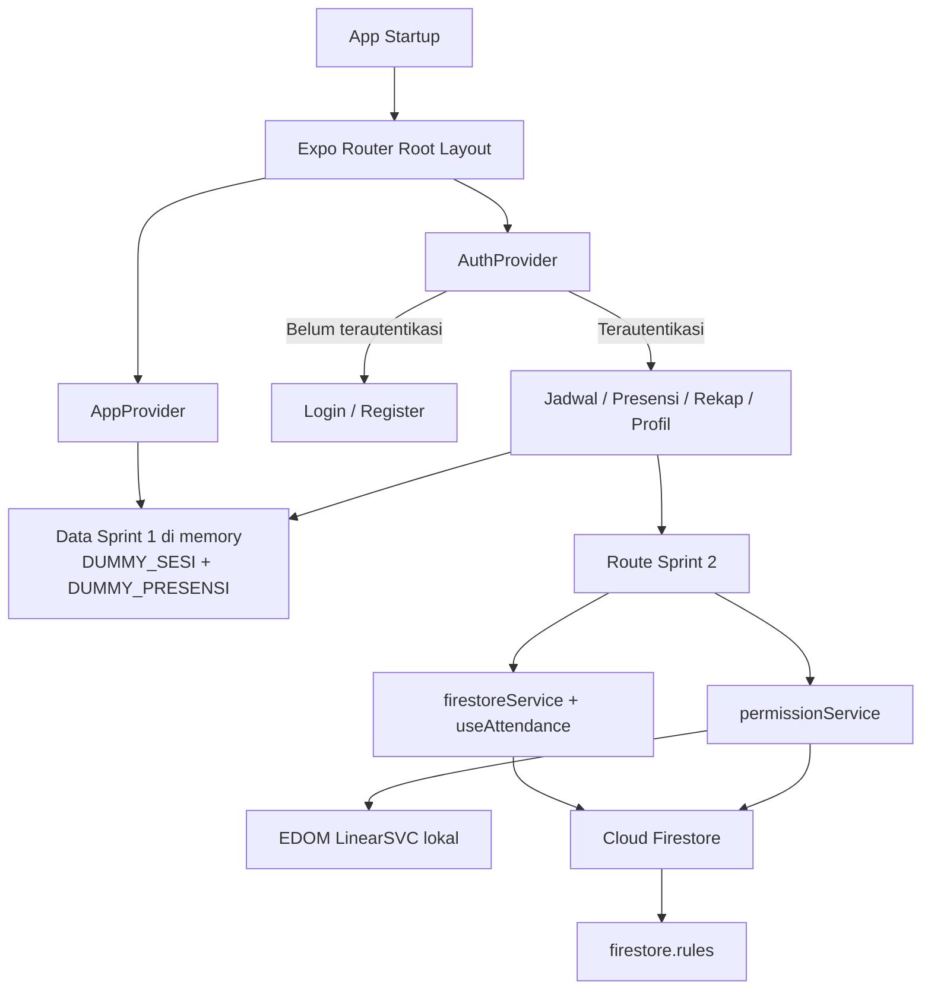

# Audit Sistem End-to-End — 19 November 2026

## Disclaimer

Dokumen ini merupakan hasil audit teknis dan berisi temuan, risiko, serta rekomendasi perbaikan. Seluruh rekomendasi bersifat opsional dan hanya dikerjakan apabila programmer atau penanggung jawab terkait memilih, menyetujui, dan menjadwalkannya. Temuan audit tidak otomatis menjadi tugas implementasi dan tidak memberikan izin untuk mengubah source code tanpa Implementation Plan yang disetujui.

## 1. Ruang Lingkup

Audit mencakup:

- konfigurasi Expo, React Native, Expo Router, EAS Build, dan Expo Update;
- bootstrap aplikasi, navigasi, autentikasi, serta otorisasi peran;
- sumber data Sprint 1 dan integrasi Cloud Firestore Sprint 2;
- CRUD sesi, presensi, realtime listener, pengajuan izin, dan review izin;
- model AI EDOM lokal;
- Firebase Security Rules dan kesesuaian query aplikasi;
- kualitas kode, dependency health, typecheck, lint, dan production web export;
- konsistensi dokumentasi dan artefak proyek.

Audit dilakukan secara statis dan melalui validasi lokal. Audit tidak mencakup penetration test terhadap project Firebase produksi, pengujian perangkat fisik, ataupun EAS cloud build.

## 2. Ringkasan Eksekutif

Proyek telah dimigrasikan dari Expo SDK 57 ke Expo SDK 58 dengan React Native 0.88.1, React 19.3, dan Expo Router 58. Konfigurasi Expo valid, dependency Expo kompatibel, typecheck lulus, Expo Doctor lulus, dan production web export berhasil menghasilkan 17 route.

Sistem belum siap dianggap production-safe. Risiko utama berada pada integritas presensi di Firestore Rules, keterpaparan daftar peserta melalui dokumen sesi, potensi akun Firebase Auth tanpa profil Firestore, dua sumber data yang berjalan bersamaan, dan dependency advisories yang perlu ditriase. ESLint juga menemukan pola effect dan JSX yang memerlukan perbaikan terpisah.

Tidak ditemukan temuan berlevel Critical. Ditemukan tiga kelompok risiko High, beberapa risiko Medium, dan sejumlah isu pemeliharaan Low.

## 3. Arsitektur Aktual

## 4. Hasil Migrasi Expo SDK 58

Perubahan utama:

- `expo`: SDK 58;
- `react-native`: 0.88.1;
- `react` dan `react-dom`: 19.3.0;
- `expo-router`: 58.0.32;
- seluruh paket Expo diselaraskan menggunakan `npx expo install --fix`;
- versi aplikasi dinaikkan dari `1.0.0` menjadi `1.1.0`;
- `runtimeVersion` tetap menggunakan kebijakan `appVersion`;
- web output ditetapkan menjadi `static` untuk menjaga perilaku ekspor web;
- typed route Expo Router diregenerasi;
- ESLint flat config resmi Expo ditambahkan.

Karena SDK native dan `expo-dev-client` berubah, development build baru diperlukan sebelum pengujian perangkat. Build SDK 57 tidak boleh digunakan untuk memvalidasi runtime SDK 58.

## 5. Hasil Validasi Teknis

| Pemeriksaan | Hasil |
| :--- | :--- |
| `npx expo install --check` | Lulus — dependency Expo kompatibel |
| `npx expo-doctor` | Lulus 20/20 |
| `npx tsc --noEmit` | Lulus |
| Typed routes | Berhasil mengenali seluruh route aplikasi |
| Production web export | Lulus — 17 route berhasil diekspor |
| `git diff --check` | Lulus |
| Native directories | `ios/` dan `android/` tidak ada; CNG tetap digunakan |
| `npx expo lint` | Gagal — 21 error dan 17 warning |
| `npm audit` | 8 advisory: 5 High dan 3 Moderate |

ESLint 10 belum kompatibel dengan plugin React yang dibawa `eslint-config-expo` saat audit dilakukan. Tooling dikunci ke ESLint major 9 agar lint dapat dijalankan tanpa menonaktifkan aturan yang menemukan masalah.

## 6. Temuan High

### H-01 — Integritas presensi belum ditegakkan di Firestore Rules

Client menggunakan ID dokumen deterministik `${sessionId}_${studentId}`, tetapi `firestore.rules` hanya memastikan `studentId` atau `praktikanId` sama dengan UID pengguna.

Rules belum memastikan:

- `attendanceId` mengikuti format deterministik;
- sesi yang dirujuk benar-benar ada;
- sesi sedang berstatus `open` atau `DIBUKA`;
- status kehadiran hanya `HADIR`, `IZIN`, atau `SAKIT`;
- field identitas dan timestamp memiliki tipe yang benar;
- pengguna hanya memiliki satu presensi per sesi.

Dampak: client yang dimodifikasi dapat membuat beberapa dokumen presensi menggunakan ID berbeda, melakukan presensi pada sesi tertutup, atau mengirim payload yang tidak valid.

Rekomendasi: pindahkan invariant presensi ke Firestore Rules dan gunakan `get()` terhadap dokumen sesi untuk memverifikasi statusnya. Tambahkan Rules Emulator test sebelum deployment.

### H-02 — Data peserta sesi dapat dibaca seluruh pengguna terautentikasi

Semua pengguna login diperbolehkan membaca koleksi `sessions`. Dokumen sesi saat ini dapat memuat `daftarPeserta` berisi nama dan NIM.

Dampak: praktikan dapat membaca daftar peserta kelas atau sesi yang tidak berkaitan dengan dirinya.

Rekomendasi: jangan simpan daftar peserta lengkap di dokumen sesi yang dibaca global. Pisahkan enrollment ke koleksi dengan rules berbasis kelas atau keanggotaan.

### H-03 — Registrasi dapat menghasilkan akun tanpa profil

Alur registrasi membuat akun Firebase Authentication sebelum menulis profil ke Firestore. Jika penulisan profil gagal, aplikasi hanya melakukan logout dan tidak menghapus akun Auth yang sudah dibuat.

Dampak: email tetap tercatat di Firebase Auth, tidak dapat didaftarkan ulang, dan tidak dapat digunakan karena aplikasi menolak akun tanpa profil valid.

Rekomendasi: gunakan rollback dengan `deleteUser()` ketika pembuatan profil gagal, atau pindahkan provisioning akun ke trusted backend.

### H-04 — Dependency advisories perlu triase

`npm audit` menemukan advisory pada rantai berikut:

- Firebase Firestore → `@grpc/grpc-js`;
- Expo CLI/Expo Updates → `node-forge`;
- Expo fingerprint → `minimatch`.

Sebagian dependency digunakan pada tooling atau jalur Node dan belum terbukti reachable pada runtime mobile. `npm audit fix` tidak boleh dijalankan secara otomatis karena rekomendasi audit mencakup downgrade yang tidak kompatibel dengan Expo SDK 58.

Rekomendasi: pantau rilis Expo dan Firebase, uji upgrade Firebase yang kompatibel, serta nilai reachability sebelum memakai `overrides`.

## 7. Temuan Medium

### M-01 — Dua sumber data berjalan bersamaan

Tab utama masih menggunakan `DUMMY_SESI` dan `DUMMY_PRESENSI` melalui `AppContext`, sedangkan route Sprint 2 menggunakan Cloud Firestore.

Dampak: status sesi dan presensi dapat berbeda antara tab utama dan layar Firestore.

Rekomendasi: tetapkan Firestore sebagai satu-satunya sumber data produksi dan hapus simulasi dummy setelah kebutuhan demo berakhir.

### M-02 — Simulasi role tidak konsisten dengan akun Firebase

UI profil dan layar sesi dapat mengganti sudut pandang praktikan/asisten secara lokal. Firebase Rules tetap membatasi backend, tetapi pengguna dapat melihat kontrol dan identitas yang tidak sesuai akun asli.

Rekomendasi: pisahkan mode demo dari build produksi atau hapus role simulator setelah evaluasi selesai.

### M-03 — Query presensi praktikan tidak sesuai dengan Rules

`useAttendance` tetap memasang listener seluruh attendance untuk sebuah sesi. Firestore Rules hanya mengizinkan praktikan membaca attendance miliknya sendiri.

Dampak: praktikan dapat menerima `permission-denied`, sementara UI hanya mencatat error ke console.

Rekomendasi: untuk praktikan, dengarkan dokumen deterministik miliknya saja. Listener seluruh sesi hanya digunakan oleh asisten.

### M-04 — Composite index pengajuan izin belum dideklarasikan

Query pengajuan praktikan memakai filter `studentId` dan pengurutan `createdAt`, tetapi repository tidak memiliki `firestore.indexes.json`.

Dampak: query dapat gagal pada Firebase project yang belum memiliki index tersebut.

Rekomendasi: tambahkan index ke source control dan referensikan dari `firebase.json`.

### M-05 — Hasil AI dapat dimanipulasi client

Klasifikasi EDOM dilakukan lokal dan `aiCategory` dikirim oleh client ke Firestore.

Dampak: client yang dimodifikasi dapat mengirim kategori AI palsu. Hasil tidak dapat digunakan sebagai bukti tepercaya untuk keputusan asisten.

Rekomendasi: pertahankan label eksperimental dan jangan jadikan hasil AI sebagai keputusan otomatis. Jika integritas dibutuhkan, lakukan inferensi pada trusted backend.

### M-06 — Hub Sprint 2 tidak memiliki jalur masuk

Route `fitur-sprint2` terdaftar pada root navigator, tetapi tidak ditautkan dari tab utama.

Dampak: fitur izin dan review sulit ditemukan tanpa deep link atau navigasi manual.

Rekomendasi: integrasikan menu berdasarkan role ke navigasi utama.

### M-07 — Lint menemukan pola render dan effect bermasalah

Lint menemukan 21 error dan 17 warning. Kelompok utama:

- pemanggilan state setter secara sinkron di dalam effect;
- dependency hook yang tidak lengkap atau tidak stabil;
- JSX quote yang belum di-escape;
- import dan variabel tidak terpakai;
- duplicate import dan default/named export ambiguity.

Rekomendasi: perbaiki berdasarkan alur data, bukan dengan menonaktifkan aturan lint secara global.

### M-08 — Implementasi kelas belum lengkap

Service mendefinisikan konstanta koleksi `classes`, tetapi belum terdapat CRUD kelas yang lengkap dan belum ada Rules untuk koleksi tersebut.

Dampak: SRS-FT-02 baru terpenuhi untuk session, belum untuk pengelolaan kelas secara utuh.

## 8. Temuan Low

- Firebase config memiliki fallback project hard-coded. Firebase client config bukan secret, tetapi environment yang salah dapat terhubung ke project default tanpa kegagalan eksplisit.
- Belum ada automated test suite; `test-farrel.tsx` merupakan layar pengujian manual.
- Beberapa route dan screen berukuran sangat besar serta menduplikasi implementasi lama.
- Seed data tidak idempotent dan dapat menambahkan session berulang kali.
- Penghapusan session tidak menangani attendance atau leave request terkait.
- Beberapa service mengembalikan array kosong ketika query gagal sehingga error dapat terlihat seperti kondisi data kosong.
- Bundle web memiliki common chunk besar; model AI dan Firebase perlu dipantau terhadap ukuran bundle native.

## 9. Audit Modul

### Autentikasi

Status: **Parsial**.

Kekuatan:

- Firebase Auth menggunakan email/password;
- sesi mobile dipersistenkan melalui AsyncStorage;
- profil dan role divalidasi sebelum aplikasi dianggap terautentikasi;
- registrasi publik dibatasi menjadi praktikan.

Kesenjangan:

- rollback akun belum lengkap;
- provisioning asisten tidak terdokumentasi sebagai workflow operasional;
- fallback Firebase config dapat menyembunyikan konfigurasi environment yang hilang.

### Navigasi dan Otorisasi

Status: **Parsial**.

Kekuatan:

- semua route memakai Expo Router;
- route izin memiliki `RoleRouteGuard`;
- typed routes SDK 58 berhasil diregenerasi.

Kesenjangan:

- route sesi dan presensi Firestore tidak memakai guard yang konsisten;
- role simulator lokal masih aktif;
- hub Sprint 2 tidak ditautkan dari tab utama.

### Sesi dan Presensi

Status: **Parsial**.

Kekuatan:

- CRUD session dan listener realtime tersedia;
- presensi memakai deterministic document ID pada client;
- UI dan service memeriksa status sesi sebelum submit.

Kesenjangan:

- invariant belum ditegakkan di Rules;
- tab utama masih memakai data dummy;
- listener praktikan tidak sepenuhnya sesuai Rules;
- data kelas dan peserta masih berupa seed/demo.

### Pengajuan dan Review Izin

Status: **Terimplementasi dengan catatan**.

Kekuatan:

- pengajuan disimpan dengan status awal `pending`;
- praktikan hanya melakukan query pengajuan miliknya;
- review memakai Firestore transaction;
- perubahan keputusan dibatasi ke field review tertentu.

Kesenjangan:

- index query belum dideklarasikan;
- duplikasi pengajuan untuk session yang sama belum dibatasi;
- `reviewedBy` menyimpan nama bebas, bukan UID reviewer yang diverifikasi Rules.

### AI EDOM

Status: **Eksperimental**.

Model menggunakan LinearSVC dengan 3.000 fitur dan label `negatif`, `netral`, serta `positif`. Model berjalan lokal tanpa API eksternal. Metadata model menyatakan bahwa model merupakan baseline penelitian dan belum divalidasi khusus untuk alasan izin praktikum.

Hasil contoh audit:

- input kosong → `empty_input`;
- alasan sakit → cenderung `negatif`;
- kalimat positif praktikum dapat diklasifikasikan `netral`.

Hasil AI hanya layak menjadi informasi pendukung.

## 10. Matriks Kepatuhan SRS

| SRS | Status | Catatan |
| :--- | :--- | :--- |
| FT-01 Autentikasi | Parsial | Login/register berjalan; rollback profil gagal belum aman |
| FT-02 CRUD sesi dan kelas | Parsial | CRUD session tersedia; kelas belum lengkap |
| FT-03 Presensi satu kali | Parsial | Dilindungi client, belum ditegakkan penuh oleh Rules |
| FT-04 Realtime sync | Parsial | Listener tersedia; query praktikan perlu diperbaiki |
| FT-05 Pengajuan izin | Terimplementasi | Perlu index dan proteksi duplikasi |
| FT-06 AI EDOM | Terimplementasi eksperimental | Inferensi lokal dan dapat dimanipulasi client |
| FT-07 Review izin | Terimplementasi | Transaction tersedia; identitas reviewer perlu diperkuat |
| FT-08 Validasi dan keamanan | Parsial | Rules tersedia tetapi invariant penting belum lengkap |

## 11. Prioritas Rekomendasi

Urutan yang disarankan apabila programmer memilih mengerjakan hasil audit:

1. Perkuat Firestore Rules dan tambahkan Rules Emulator test.
2. Hilangkan dua sumber data dan jadikan Firestore sumber utama.
3. Perbaiki rollback registrasi akun.
4. Selaraskan query praktikan dengan Rules dan tambahkan Firestore indexes.
5. Perbaiki error ESLint tanpa menonaktifkan aturan.
6. Integrasikan navigasi berdasarkan role dan isolasi mode demo.
7. Tambahkan automated tests untuk auth, presensi, izin, dan AI fallback.
8. Triase dependency advisories berdasarkan reachability dan rilis upstream.

## 12. Pembersihan Dokumentasi

Dokumen berikut dihapus setelah audit karena redundan, historis, atau tidak lagi akurat:

- `diagram.md`;
- `implementasi.md`;
- `implementation_plan.md`;
- `revisibos.md`.

Dokumen yang tetap menjadi sumber dokumentasi proyek:

- `README.md`;
- `PRAKMOBILE1.md`;
- `PRAKMOBILE2.md`;
- `AGENTS.md`;
- `AUDITSYS19NOV.md`.

