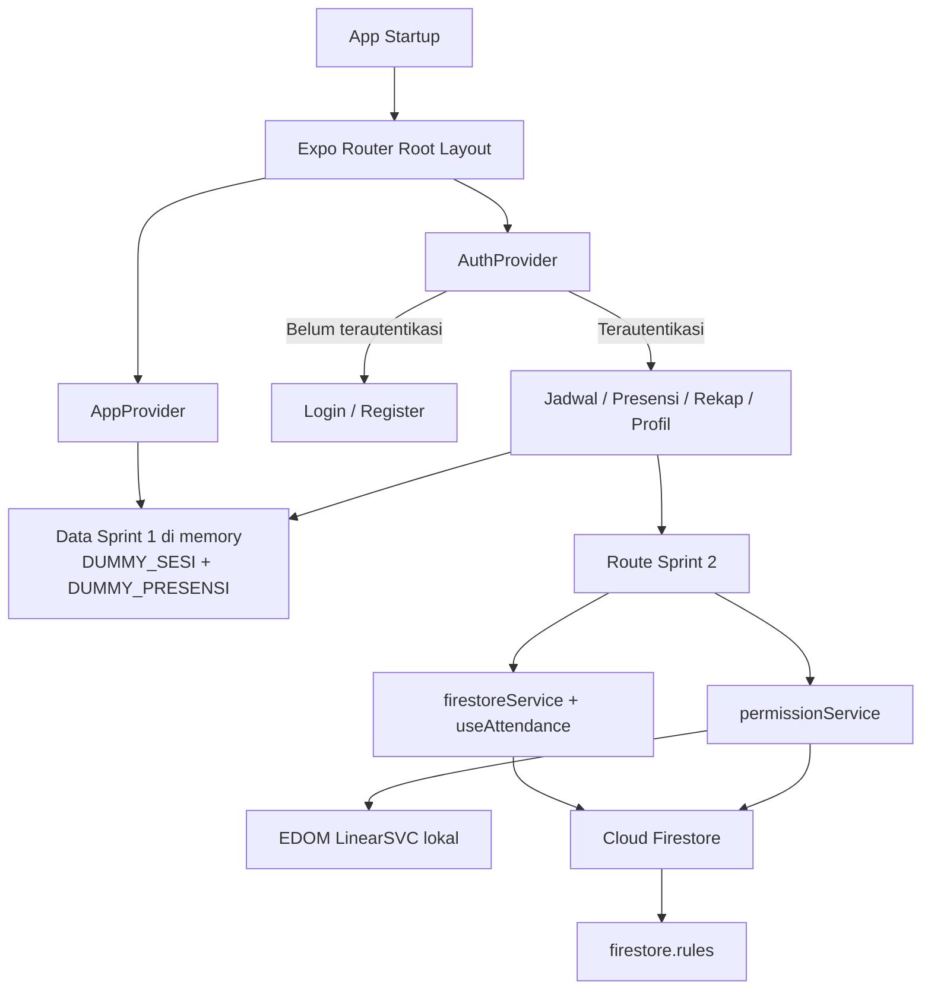
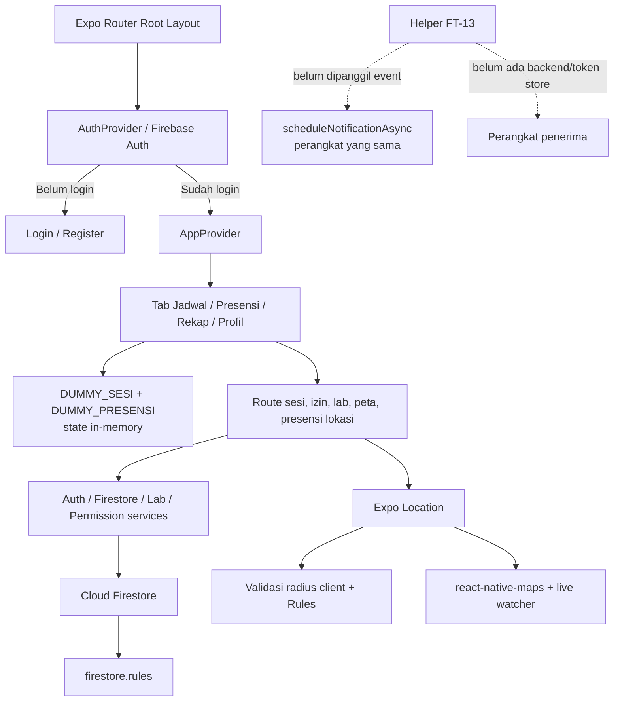

# Audit Sistem End-to-End — 19 November 2026

## Disclaimer

Dokumen ini merupakan hasil audit teknis dan berisi temuan, risiko, serta rekomendasi perbaikan. Seluruh rekomendasi bersifat opsional dan hanya dikerjakan apabila programmer atau penanggung jawab terkait memilih, menyetujui, dan menjadwalkannya. Temuan audit tidak otomatis menjadi tugas implementasi dan tidak memberikan izin untuk mengubah source code tanpa Implementation Plan yang disetujui.

## 1. Ruang Lingkup

Audit mencakup:

- konfigurasi Expo, React Native, Expo Router, EAS Build, dan Expo Update;
- bootstrap aplikasi, navigasi, autentikasi, serta otorisasi peran;
- sumber data Sprint 1 dan integrasi Cloud Firestore Sprint 2;
- CRUD sesi, presensi, realtime listener, pengajuan izin, dan review izin;
- model AI EDOM lokal;
- Firebase Security Rules dan kesesuaian query aplikasi;
- kualitas kode, dependency health, typecheck, lint, dan production web export;
- konsistensi dokumentasi dan artefak proyek.

Audit dilakukan secara statis dan melalui validasi lokal. Audit tidak mencakup penetration test terhadap project Firebase produksi, pengujian perangkat fisik, ataupun EAS cloud build.

## 2. Ringkasan Eksekutif

Proyek telah dimigrasikan dari Expo SDK 57 ke Expo SDK 58 dengan React Native 0.88.1, React 19.3, dan Expo Router 58. Konfigurasi Expo valid, dependency Expo kompatibel, typecheck lulus, Expo Doctor lulus, dan production web export berhasil menghasilkan 17 route.

Sistem belum siap dianggap production-safe. Risiko utama berada pada integritas presensi di Firestore Rules, keterpaparan daftar peserta melalui dokumen sesi, potensi akun Firebase Auth tanpa profil Firestore, dua sumber data yang berjalan bersamaan, dan dependency advisories yang perlu ditriase. ESLint juga menemukan pola effect dan JSX yang memerlukan perbaikan terpisah.

Tidak ditemukan temuan berlevel Critical. Ditemukan tiga kelompok risiko High, beberapa risiko Medium, dan sejumlah isu pemeliharaan Low.

## 3. Arsitektur Aktual

## 4. Hasil Migrasi Expo SDK 58

Perubahan utama:

- `expo`: SDK 58;
- `react-native`: 0.88.1;
- `react` dan `react-dom`: 19.3.0;
- `expo-router`: 58.0.32;
- seluruh paket Expo diselaraskan menggunakan `npx expo install --fix`;
- versi aplikasi dinaikkan dari `1.0.0` menjadi `1.1.0`;
- `runtimeVersion` tetap menggunakan kebijakan `appVersion`;
- web output ditetapkan menjadi `static` untuk menjaga perilaku ekspor web;
- typed route Expo Router diregenerasi;
- ESLint flat config resmi Expo ditambahkan.

Karena SDK native dan `expo-dev-client` berubah, development build baru diperlukan sebelum pengujian perangkat. Build SDK 57 tidak boleh digunakan untuk memvalidasi runtime SDK 58.

## 5. Hasil Validasi Teknis

| Pemeriksaan | Hasil |
| :--- | :--- |
| `npx expo install --check` | Lulus — dependency Expo kompatibel |
| `npx expo-doctor` | Lulus 20/20 |
| `npx tsc --noEmit` | Lulus |
| Typed routes | Berhasil mengenali seluruh route aplikasi |
| Production web export | Lulus — 17 route berhasil diekspor |
| `git diff --check` | Lulus |
| Native directories | `ios/` dan `android/` tidak ada; CNG tetap digunakan |
| `npx expo lint` | Gagal — 21 error dan 17 warning |
| `npm audit` | 8 advisory: 5 High dan 3 Moderate |

ESLint 10 belum kompatibel dengan plugin React yang dibawa `eslint-config-expo` saat audit dilakukan. Tooling dikunci ke ESLint major 9 agar lint dapat dijalankan tanpa menonaktifkan aturan yang menemukan masalah.

## 6. Temuan High

### H-01 — Integritas presensi belum ditegakkan di Firestore Rules

Client menggunakan ID dokumen deterministik `${sessionId}_${studentId}`, tetapi `firestore.rules` hanya memastikan `studentId` atau `praktikanId` sama dengan UID pengguna.

Rules belum memastikan:

- `attendanceId` mengikuti format deterministik;
- sesi yang dirujuk benar-benar ada;
- sesi sedang berstatus `open` atau `DIBUKA`;
- status kehadiran hanya `HADIR`, `IZIN`, atau `SAKIT`;
- field identitas dan timestamp memiliki tipe yang benar;
- pengguna hanya memiliki satu presensi per sesi.

Dampak: client yang dimodifikasi dapat membuat beberapa dokumen presensi menggunakan ID berbeda, melakukan presensi pada sesi tertutup, atau mengirim payload yang tidak valid.

Rekomendasi: pindahkan invariant presensi ke Firestore Rules dan gunakan `get()` terhadap dokumen sesi untuk memverifikasi statusnya. Tambahkan Rules Emulator test sebelum deployment.

### H-02 — Data peserta sesi dapat dibaca seluruh pengguna terautentikasi

Semua pengguna login diperbolehkan membaca koleksi `sessions`. Dokumen sesi saat ini dapat memuat `daftarPeserta` berisi nama dan NIM.

Dampak: praktikan dapat membaca daftar peserta kelas atau sesi yang tidak berkaitan dengan dirinya.

Rekomendasi: jangan simpan daftar peserta lengkap di dokumen sesi yang dibaca global. Pisahkan enrollment ke koleksi dengan rules berbasis kelas atau keanggotaan.

### H-03 — Registrasi dapat menghasilkan akun tanpa profil

Alur registrasi membuat akun Firebase Authentication sebelum menulis profil ke Firestore. Jika penulisan profil gagal, aplikasi hanya melakukan logout dan tidak menghapus akun Auth yang sudah dibuat.

Dampak: email tetap tercatat di Firebase Auth, tidak dapat didaftarkan ulang, dan tidak dapat digunakan karena aplikasi menolak akun tanpa profil valid.

Rekomendasi: gunakan rollback dengan `deleteUser()` ketika pembuatan profil gagal, atau pindahkan provisioning akun ke trusted backend.

### H-04 — Dependency advisories perlu triase

`npm audit` menemukan advisory pada rantai berikut:

- Firebase Firestore → `@grpc/grpc-js`;
- Expo CLI/Expo Updates → `node-forge`;
- Expo fingerprint → `minimatch`.

Sebagian dependency digunakan pada tooling atau jalur Node dan belum terbukti reachable pada runtime mobile. `npm audit fix` tidak boleh dijalankan secara otomatis karena rekomendasi audit mencakup downgrade yang tidak kompatibel dengan Expo SDK 58.

Rekomendasi: pantau rilis Expo dan Firebase, uji upgrade Firebase yang kompatibel, serta nilai reachability sebelum memakai `overrides`.

## 7. Temuan Medium

### M-01 — Dua sumber data berjalan bersamaan

Tab utama masih menggunakan `DUMMY_SESI` dan `DUMMY_PRESENSI` melalui `AppContext`, sedangkan route Sprint 2 menggunakan Cloud Firestore.

Dampak: status sesi dan presensi dapat berbeda antara tab utama dan layar Firestore.

Rekomendasi: tetapkan Firestore sebagai satu-satunya sumber data produksi dan hapus simulasi dummy setelah kebutuhan demo berakhir.

### M-02 — Simulasi role tidak konsisten dengan akun Firebase

UI profil dan layar sesi dapat mengganti sudut pandang praktikan/asisten secara lokal. Firebase Rules tetap membatasi backend, tetapi pengguna dapat melihat kontrol dan identitas yang tidak sesuai akun asli.

Rekomendasi: pisahkan mode demo dari build produksi atau hapus role simulator setelah evaluasi selesai.

### M-03 — Query presensi praktikan tidak sesuai dengan Rules

`useAttendance` tetap memasang listener seluruh attendance untuk sebuah sesi. Firestore Rules hanya mengizinkan praktikan membaca attendance miliknya sendiri.

Dampak: praktikan dapat menerima `permission-denied`, sementara UI hanya mencatat error ke console.

Rekomendasi: untuk praktikan, dengarkan dokumen deterministik miliknya saja. Listener seluruh sesi hanya digunakan oleh asisten.

### M-04 — Composite index pengajuan izin belum dideklarasikan

Query pengajuan praktikan memakai filter `studentId` dan pengurutan `createdAt`, tetapi repository tidak memiliki `firestore.indexes.json`.

Dampak: query dapat gagal pada Firebase project yang belum memiliki index tersebut.

Rekomendasi: tambahkan index ke source control dan referensikan dari `firebase.json`.

### M-05 — Hasil AI dapat dimanipulasi client

Klasifikasi EDOM dilakukan lokal dan `aiCategory` dikirim oleh client ke Firestore.

Dampak: client yang dimodifikasi dapat mengirim kategori AI palsu. Hasil tidak dapat digunakan sebagai bukti tepercaya untuk keputusan asisten.

Rekomendasi: pertahankan label eksperimental dan jangan jadikan hasil AI sebagai keputusan otomatis. Jika integritas dibutuhkan, lakukan inferensi pada trusted backend.

### M-06 — Hub Sprint 2 tidak memiliki jalur masuk

Route `fitur-sprint2` terdaftar pada root navigator, tetapi tidak ditautkan dari tab utama.

Dampak: fitur izin dan review sulit ditemukan tanpa deep link atau navigasi manual.

Rekomendasi: integrasikan menu berdasarkan role ke navigasi utama.

### M-07 — Lint menemukan pola render dan effect bermasalah

Lint menemukan 21 error dan 17 warning. Kelompok utama:

- pemanggilan state setter secara sinkron di dalam effect;
- dependency hook yang tidak lengkap atau tidak stabil;
- JSX quote yang belum di-escape;
- import dan variabel tidak terpakai;
- duplicate import dan default/named export ambiguity.

Rekomendasi: perbaiki berdasarkan alur data, bukan dengan menonaktifkan aturan lint secara global.

### M-08 — Implementasi kelas belum lengkap

Service mendefinisikan konstanta koleksi `classes`, tetapi belum terdapat CRUD kelas yang lengkap dan belum ada Rules untuk koleksi tersebut.

Dampak: SRS-FT-02 baru terpenuhi untuk session, belum untuk pengelolaan kelas secara utuh.

## 8. Temuan Low

- Firebase config memiliki fallback project hard-coded. Firebase client config bukan secret, tetapi environment yang salah dapat terhubung ke project default tanpa kegagalan eksplisit.
- Belum ada automated test suite; `test-farrel.tsx` merupakan layar pengujian manual.
- Beberapa route dan screen berukuran sangat besar serta menduplikasi implementasi lama.
- Seed data tidak idempotent dan dapat menambahkan session berulang kali.
- Penghapusan session tidak menangani attendance atau leave request terkait.
- Beberapa service mengembalikan array kosong ketika query gagal sehingga error dapat terlihat seperti kondisi data kosong.
- Bundle web memiliki common chunk besar; model AI dan Firebase perlu dipantau terhadap ukuran bundle native.

## 9. Audit Modul

### Autentikasi

Status: **Parsial**.

Kekuatan:

- Firebase Auth menggunakan email/password;
- sesi mobile dipersistenkan melalui AsyncStorage;
- profil dan role divalidasi sebelum aplikasi dianggap terautentikasi;
- registrasi publik dibatasi menjadi praktikan.

Kesenjangan:

- rollback akun belum lengkap;
- provisioning asisten tidak terdokumentasi sebagai workflow operasional;
- fallback Firebase config dapat menyembunyikan konfigurasi environment yang hilang.

### Navigasi dan Otorisasi

Status: **Parsial**.

Kekuatan:

- semua route memakai Expo Router;
- route izin memiliki `RoleRouteGuard`;
- typed routes SDK 58 berhasil diregenerasi.

Kesenjangan:

- route sesi dan presensi Firestore tidak memakai guard yang konsisten;
- role simulator lokal masih aktif;
- hub Sprint 2 tidak ditautkan dari tab utama.

### Sesi dan Presensi

Status: **Parsial**.

Kekuatan:

- CRUD session dan listener realtime tersedia;
- presensi memakai deterministic document ID pada client;
- UI dan service memeriksa status sesi sebelum submit.

Kesenjangan:

- invariant belum ditegakkan di Rules;
- tab utama masih memakai data dummy;
- listener praktikan tidak sepenuhnya sesuai Rules;
- data kelas dan peserta masih berupa seed/demo.

### Pengajuan dan Review Izin

Status: **Terimplementasi dengan catatan**.

Kekuatan:

- pengajuan disimpan dengan status awal `pending`;
- praktikan hanya melakukan query pengajuan miliknya;
- review memakai Firestore transaction;
- perubahan keputusan dibatasi ke field review tertentu.

Kesenjangan:

- index query belum dideklarasikan;
- duplikasi pengajuan untuk session yang sama belum dibatasi;
- `reviewedBy` menyimpan nama bebas, bukan UID reviewer yang diverifikasi Rules.

### AI EDOM

Status: **Eksperimental**.

Model menggunakan LinearSVC dengan 3.000 fitur dan label `negatif`, `netral`, serta `positif`. Model berjalan lokal tanpa API eksternal. Metadata model menyatakan bahwa model merupakan baseline penelitian dan belum divalidasi khusus untuk alasan izin praktikum.

Hasil contoh audit:

- input kosong → `empty_input`;
- alasan sakit → cenderung `negatif`;
- kalimat positif praktikum dapat diklasifikasikan `netral`.

Hasil AI hanya layak menjadi informasi pendukung.

## 10. Matriks Kepatuhan SRS

| SRS | Status | Catatan |
| :--- | :--- | :--- |
| FT-01 Autentikasi | Parsial | Login/register berjalan; rollback profil gagal belum aman |
| FT-02 CRUD sesi dan kelas | Parsial | CRUD session tersedia; kelas belum lengkap |
| FT-03 Presensi satu kali | Parsial | Dilindungi client, belum ditegakkan penuh oleh Rules |
| FT-04 Realtime sync | Parsial | Listener tersedia; query praktikan perlu diperbaiki |
| FT-05 Pengajuan izin | Terimplementasi | Perlu index dan proteksi duplikasi |
| FT-06 AI EDOM | Terimplementasi eksperimental | Inferensi lokal dan dapat dimanipulasi client |
| FT-07 Review izin | Terimplementasi | Transaction tersedia; identitas reviewer perlu diperkuat |
| FT-08 Validasi dan keamanan | Parsial | Rules tersedia tetapi invariant penting belum lengkap |

## 11. Prioritas Rekomendasi

Urutan yang disarankan apabila programmer memilih mengerjakan hasil audit:

1. Perkuat Firestore Rules dan tambahkan Rules Emulator test.
2. Hilangkan dua sumber data dan jadikan Firestore sumber utama.
3. Perbaiki rollback registrasi akun.
4. Selaraskan query praktikan dengan Rules dan tambahkan Firestore indexes.
5. Perbaiki error ESLint tanpa menonaktifkan aturan.
6. Integrasikan navigasi berdasarkan role dan isolasi mode demo.
7. Tambahkan automated tests untuk auth, presensi, izin, dan AI fallback.
8. Triase dependency advisories berdasarkan reachability dan rilis upstream.

## 12. Pembersihan Dokumentasi

Dokumen berikut dihapus setelah audit karena redundan, historis, atau tidak lagi akurat:

- `diagram.md`;
- `implementasi.md`;
- `implementation_plan.md`;
- `revisibos.md`.

Dokumen yang tetap menjadi sumber dokumentasi proyek:

- `README.md`;
- `PRAKMOBILE1.md`;
- `PRAKMOBILE2.md`;
- `AGENTS.md`;
- `AUDITSYS19NOV.md`.

---

## 13. Addendum Audit Ulang - 21 November 2026

### 13.1 Tujuan, Baseline, dan Batasan

Addendum ini memperbarui audit 19 November tanpa menghapus histori temuan lama. Audit ulang dilakukan terhadap commit berikut:

- `11c9e0b` - perbaikan pengambilan lokasi ketika sesi/lab belum tersedia;
- `2dfe09f` - perbaikan resolusi dependency WebSocket untuk Expo tunnel;
- seluruh implementasi Sprint 1, Sprint 2, dan Sprint 3 sampai 21 November 2026.

Baseline repository ketika audit dimulai:

- 92 tracked files;
- 65 source files JavaScript/TypeScript;
- sekitar 15.612 baris source pada `src/` dan `ai/`;
- 34 file `.tsx`, 28 file `.js`, dan 4 file `.ts` di repository;
- `ios/` dan `android/` tidak ada, sehingga proyek tetap menggunakan Continuous Native Generation;
- working tree bersih setelah dua commit perbaikan di atas;
- tidak ditemukan `.env` yang tracked; hanya `.env.example` yang masuk source control.

Audit ini meliputi pembacaan source, pemeriksaan konfigurasi, dependency tree, Firestore Rules, route, data flow, lint, typecheck, Expo Doctor, production web export, dan pengujian startup Expo tunnel. Audit tidak melakukan:

- penetration test terhadap Firebase project produksi;
- deployment Firestore Rules ke project produksi;
- Rules Emulator test karena test suite belum tersedia;
- pengujian GPS, Maps, notification delivery, dan permission pada perangkat fisik;
- EAS cloud build atau store submission;
- verifikasi pembatasan Google Maps API key di Google Cloud Console.

### 13.2 Arsitektur Aktual Setelah Sprint 3

Arsitektur masih memiliki dua jalur data. Tab utama memakai data dummy dari `AppContext`, sedangkan fitur Sprint 2 dan Sprint 3 memakai Firestore. Route dan UI terlihat terintegrasi, tetapi status sesi/presensi pada kedua jalur dapat berbeda.

### 13.3 Hasil Validasi Teknis Terkini

| Pemeriksaan | Hasil 21 November 2026 |
| :--- | :--- |
| `npx expo install --check` | Lulus - dependency Expo sesuai SDK 58 |
| `npx expo-doctor` | Lulus 20/20 |
| `npx tsc --noEmit` | Lulus; catatan: sebagian besar file `.js` tidak memperoleh jaminan type safety setara `.ts/.tsx` |
| `npx expo config --type public` | Lulus; SDK 58, package Android, bundle identifier iOS, Updates URL, dan project ID terbaca |
| `npm ls @expo/ws-tunnel ws --all` | Lulus; tunnel memakai `ws@8.23.0`, sedangkan React Native/Metro memakai nested `ws@7.5.14` |
| Expo tunnel development client | Lulus pada port 8082; QR dan URL `on.expo.app` berhasil dibuat |
| Production web export | Lulus; 20 HTML output, 79 file, sekitar 8,0 MB total output |
| JavaScript hasil web export | Sekitar 3,30 MB; common chunk 1,65 MB dan entry chunk 1,12 MB |
| `git diff --check` | Lulus sebelum penulisan addendum |
| `npx expo lint --no-cache` | Gagal - 12 error dan 20 warning |
| `npm audit` | 8 advisory: 5 High, 3 Moderate, 0 Critical |
| Automated tests | Tidak tersedia; `src/app/test-farrel.tsx` adalah layar pengujian manual, bukan automated test |

Kelompok lint saat audit ulang:

- 8 `react-hooks/set-state-in-effect`;
- 2 `react-hooks/static-components`;
- 2 `react/no-unescaped-entities`;
- 1 `react-hooks/exhaustive-deps`;
- 11 unused variable/import warning;
- 3 ambiguity default/named import;
- 2 duplicate import warning.

Targeted lint untuk `AttendanceCheckScreen.js` dan `RadiusStatusCard.js` lulus setelah perbaikan lokasi.

### 13.4 Delta terhadap Audit 19 November

| Temuan Lama | Status Audit Ulang | Bukti/Perubahan |
| :--- | :--- | :--- |
| H-01 Integritas presensi belum ditegakkan Rules | **Sebagian besar terselesaikan** | `firestore.rules:65-143` kini memvalidasi ID deterministik, UID, sesi terbuka, lab aktif, timestamp, radius, dan selisih jarak. Risiko spoofing koordinat, role, enrollment, serta identitas profil masih tersisa. |
| H-02 Data peserta sesi terbuka | **Masih berlaku** | `sessions` dapat dibaca semua pengguna login (`firestore.rules:189-196`) dan payload masih membawa `daftarPeserta`. |
| H-03 Akun Auth tanpa profil | **Masih berlaku** | Kegagalan penulisan profil hanya melakukan `signOut()`, bukan `deleteUser()` (`src/services/authService.js:90-128`). |
| H-04 Dependency advisories | **Masih berlaku** | Tetap 5 High dan 3 Moderate. |
| M-01 Dua sumber data | **Masih berlaku** | `AppContext` tetap memakai `DUMMY_SESI` dan `DUMMY_PRESENSI`; route baru memakai Firestore. |
| M-02 Simulasi role | **Masih berlaku** | Pengalih role tersedia pada header, profil, tab presensi, dan `sesi.tsx`. Backend tetap terlindungi Rules, tetapi UI dapat menampilkan kontrol role lain. |
| M-03 Query attendance praktikan vs Rules | **Sebagian terselesaikan** | Flow utama `AttendanceCheckScreen` memakai dokumen deterministik milik user. Listener seluruh attendance masih ada di `useAttendance` dan dapat terpicu melalui simulator/route legacy. |
| M-04 Index izin | **Masih berlaku** | Tidak ada `firestore.indexes.json`, sedangkan query memakai `studentId ==` dan `orderBy(createdAt desc)`. |
| M-05 AI dapat dimanipulasi client | **Masih berlaku** | Hasil AI tetap dihitung dan dikirim client. Label eksperimental sudah dipertahankan. |
| M-06 Hub Sprint 2 tidak memiliki jalur masuk | **Masih berlaku** | `fitur-sprint2` terdaftar tetapi tidak ditautkan dari tab utama; fitur izin/review bergantung deep link atau route hub tersebut. |
| M-07 Lint | **Membaik tetapi belum lulus** | Dari 21 error/17 warning menjadi 12 error/20 warning pada run tanpa cache. |
| M-08 Kelas belum lengkap | **Masih berlaku** | Konstanta `classes` ada, tetapi CRUD, Rules, dan model enrollment kelas belum tersedia. |

### 13.5 Temuan Audit Ulang - Critical

Tidak ditemukan temuan Critical dari pemeriksaan statis. Kesimpulan ini tidak menggantikan penetration test, Rules Emulator test, atau pengujian Firebase produksi.

### 13.6 Temuan Audit Ulang - High

#### A21-H01 - FT-13 belum mengirim push notification ke perangkat penerima

`notificationService.js` dapat memperoleh Expo Push Token dan mendefinisikan helper sesi/jadwal/izin, tetapi:

- tidak ada pemanggil `notifySessionOpened`, `notifyScheduleChanged`, atau `notifyLeaveDecision` di source selain definisinya sendiri;
- push token tidak pernah disimpan atau dikaitkan dengan UID pengguna;
- tidak ada backend/Cloud Function yang mengirim ke Expo Push Service;
- helper event memakai `scheduleNotificationAsync`, sehingga notifikasi muncul pada perangkat yang menjalankan fungsi, bukan perangkat mahasiswa target;
- `targetStudentIds` hanya disimpan sebagai metadata local notification dan tidak mengatur penerima;
- listener receive/response juga belum dipasang oleh aplikasi;
- `app.json` belum mendaftarkan config plugin `expo-notifications`;
- Android notification channel tidak dibuat sebelum pengambilan push token. Pada Android 13, permission prompt/token flow membutuhkan channel terlebih dahulu.

Bukti utama: `src/services/notificationService.js:15-218`, pencarian penggunaan helper, serta `app.json:32-48`.

Dampak: pembukaan sesi, perubahan jadwal, dan keputusan izin tidak dikirim ke pengguna terkait. Pesan sukses helper berpotensi memberi kesan pengiriman remote berhasil padahal hanya local scheduling.

Rekomendasi: buat lifecycle token per UID/perangkat, Firestore Rules untuk token, backend trusted untuk fan-out, pemicu event yang idempotent, Android channel, config plugin/credentials, listener navigation, dan delivery receipt handling.

#### A21-H02 - Validasi radius belum membuktikan lokasi asli dan belum membatasi enrollment

Rules sekarang menghitung ulang jarak dan menolak nilai `distanceMeters` yang tidak cocok. Perbaikan ini menutup banyak celah audit lama. Namun `attendance.location` tetap dikirim oleh client. Client yang dimodifikasi dapat mengirim koordinat laboratorium beserta timestamp baru dan memenuhi Rules.

Selain itu, `validAttendanceCreate()` belum memastikan:

- profil pemohon memiliki role `praktikan`;
- praktikan terdaftar pada sesi atau kelas terkait;
- `studentName`, `studentNim`, dan `studentClass` sama dengan dokumen `users/{uid}`;
- akurasi lokasi berada di bawah ambang yang dapat diterima.

Dampak: akun apa pun yang terautentikasi, termasuk asisten atau praktikan dari kelas lain, dapat membuat attendance untuk sesi terbuka selama payload memenuhi struktur. Identitas tampilan dan koordinat dapat dipalsukan oleh client yang dimodifikasi.

Rekomendasi: validasi role dan canonical profile pada Rules, bangun enrollment berbasis UID, tetapkan kebijakan accuracy, aktifkan App Check sebagai defense-in-depth, dan dokumentasikan batas bahwa GPS client tidak dapat dianggap bukti anti-spoof yang absolut.

#### A21-H03 - Data peserta sesi masih terbuka untuk seluruh pengguna login

`firestore.rules:190` mengizinkan seluruh pengguna terautentikasi membaca semua sesi. `firestoreService.js` dan seed data menyimpan `daftarPeserta` berupa nama dan NIM di dokumen yang sama.

Dampak: pengguna dapat membaca daftar peserta sesi/kelas lain. Firestore Rules tidak dapat menyembunyikan sebagian field dari dokumen yang sudah diizinkan dibaca.

Rekomendasi: pisahkan data publik sesi dan enrollment privat, gunakan UID sebagai referensi, dan batasi query enrollment berdasarkan asisten atau kepemilikan pengguna.

#### A21-H04 - Registrasi masih dapat meninggalkan akun Firebase Auth tanpa profil

Alur `registerUser()` membuat akun Auth terlebih dahulu. Jika `updateProfile()` atau `setDoc(users/{uid})` gagal, catch hanya memanggil `signOut(auth)`.

Dampak: email sudah terdaftar tetapi akun tidak dapat melewati validasi profil aplikasi dan tidak dapat didaftarkan ulang secara normal.

Rekomendasi: lakukan rollback `deleteUser(user)` ketika provisioning profil gagal, atau pindahkan provisioning ke backend trusted yang memiliki mekanisme transaksi/kompensasi dan logging.

#### A21-H05 - Dependency advisories belum terselesaikan

`npm audit` melaporkan:

- jalur Firebase Firestore ke `@grpc/grpc-js` - High;
- `node-forge` melalui Expo CLI, Expo code signing, dan Expo Updates - High;
- `minimatch` melalui Expo fingerprint - Moderate.

`npm audit` menawarkan downgrade lintas major ke Expo 52/Firebase 9 untuk sebagian advisory, sehingga `npm audit fix --force` tidak aman digunakan. `firebase` saat audit berada pada 13.2.0, sedangkan versi wanted/latest yang terlihat adalah 13.4.0.

Rekomendasi: uji upgrade Firebase yang kompatibel, pantau patch Expo SDK 58, nilai reachability mobile vs tooling, dan jangan menggunakan override/downgrade tanpa regression test.

### 13.7 Temuan Audit Ulang - Medium

#### A21-M01 - Dua sumber data dan role simulator tetap aktif pada jalur produksi

Tab utama memakai state dummy, sedangkan route Sprint 2/3 memakai Firestore. Pengguna juga dapat mengganti role tampilan menjadi asisten. Pada `sesi.tsx`, praktikan dapat membuka tampilan CRUD asisten; Rules menolak write, tetapi UI menampilkan aksi yang tidak berwenang dan dapat memicu listener yang ditolak.

Rekomendasi: jadikan Firestore sumber produksi tunggal dan aktifkan simulator hanya melalui development flag/build khusus demo.

#### A21-M02 - Rules pengajuan izin belum cukup ketat

Create rule hanya memakai `hasAll`, bukan `hasOnly`, dan belum memvalidasi role, tipe, panjang alasan, session existence, session ownership/enrollment, `createdAt == request.time`, atau duplikasi pengajuan per sesi. Review menyimpan nama bebas pada `reviewedBy` dan tidak mengikatnya ke UID reviewer.

Rekomendasi: gunakan ID deterministik atau uniqueness strategy, validasi field/type/timestamp/session, batasi create ke praktikan, dan simpan `reviewedByUid` dari `request.auth.uid`.

#### A21-M03 - Index query izin belum dideklarasikan di repository

Query `studentId == ...` dengan `orderBy(createdAt, desc)` memerlukan index manual. Repository hanya mereferensikan `firestore.rules`; tidak ada `firestore.indexes.json` pada `firebase.json`.

Rekomendasi: deklarasikan dan deploy index bersama Rules agar environment baru dapat direproduksi.

#### A21-M04 - Menonaktifkan lab dapat mengunci sesi aktif

Lab dapat diubah menjadi `isActive: false` tanpa memeriksa sesi terkait. Rules session mensyaratkan `labExistsAndActive()` pada setiap update. Akibatnya sesi yang menunjuk lab nonaktif tidak dapat ditutup atau diedit sampai lab diaktifkan kembali; attendance juga langsung ditolak.

Rekomendasi: larang deactivation saat ada sesi terbuka, atau lakukan transaksi terkoordinasi yang menutup/memindahkan sesi sebelum lab dinonaktifkan.

#### A21-M05 - Data lokasi presensi belum memiliki kebijakan privasi dan retensi

Attendance menyimpan GeoPoint presisi, akurasi, jarak, dan waktu pengambilan. Asisten dapat membaca data tersebut tanpa kebijakan retensi, penghapusan, atau minimisasi yang terdokumentasi.

Rekomendasi: tentukan tujuan, masa retensi, akses, penghapusan, dan pemberitahuan privasi. Pertimbangkan menyimpan hasil validasi/radius tanpa mempertahankan koordinat presisi lebih lama dari kebutuhan audit.

#### A21-M06 - Typecheck tidak mencakup kualitas sebagian besar modul JavaScript

TypeScript strict aktif, tetapi 28 file `.js` mencakup auth, service, hook, maps, notification, dan screen besar. `tsc --noEmit` dapat lulus meskipun kesalahan tipe pada file JavaScript tidak terdeteksi.

Rekomendasi: migrasikan service/hook kritis ke TypeScript atau aktifkan strategi `checkJs` bertahap dengan JSDoc yang tervalidasi.

#### A21-M07 - Automated test dan Rules test belum tersedia

Tidak ada unit, integration, E2E, atau Firestore Rules Emulator test. Layar `test-farrel.tsx` adalah manual test route dan tetap masuk production route/export.

Rekomendasi: prioritaskan Rules tests untuk auth, enrollment, radius, duplicate attendance, izin, dan role; kemudian tambah service tests serta E2E untuk jalur login-presensi-review.

#### A21-M08 - Lint dan ukuran modul menunjukkan debt pemeliharaan

Lint masih gagal 12 error/20 warning. `src/app/sesi.tsx` sekitar 1.410 baris, beberapa screen lain 500-700 baris, dan komponen dibuat saat render pada `LabActivitySheet`.

Rekomendasi: perbaiki effect berdasarkan data flow, pindahkan komponen statis keluar render, pecah screen berdasarkan tanggung jawab, dan jangan menonaktifkan aturan lint secara global.

#### A21-M09 - Navigasi fitur izin dan route evaluasi belum production-ready

`fitur-sprint2` dan `test-farrel` terdaftar sebagai route tetapi tidak memiliki jalur normal dari tab utama. Fitur izin/review menjadi sulit ditemukan, sementara test route tetap dapat dibuka melalui deep link oleh pengguna login.

Rekomendasi: integrasikan menu izin berdasarkan role dan keluarkan route evaluasi dari production build.

### 13.8 Temuan Audit Ulang - Low

- Accessibility coverage rendah: ditemukan sekitar 108 `TouchableOpacity`, 5 `Pressable`, tetapi hanya 8 accessibility props. Banyak tombol ikon belum memiliki label/role/state yang memadai.
- Google Maps API key dan fallback Firebase client config tersimpan pada tracked source. Firebase client config bukan server secret, tetapi Google Maps key harus dibatasi berdasarkan Android package/SHA dan API yang diperlukan.
- `package.json` masih version `1.0.0`, sedangkan `app.json` version `1.1.0`.
- Banyak route memakai cast `as any`, sehingga typed routes tidak memberikan perlindungan penuh.
- Seed session tidak idempotent dan membawa identitas/NIM contoh ke Firestore.
- Delete session tidak menangani attendance atau leave request yang menjadi orphan.
- `getStudentAttendanceHistory()` mengembalikan array kosong saat query gagal, sehingga error dapat terlihat seperti kondisi tanpa data.
- Tanggal `26 Okt`, identitas demo, kelas, ruangan, dan nama asisten masih hard-coded pada beberapa UI/service.
- Dokumentasi README masih berfokus pada Sprint 1-2; struktur dan alur Sprint 3 belum direkonsiliasi. `PRAKMOBILE3.md` juga masih menyarankan `git add .`, bertentangan dengan `AGENTS.md`.
- Common dan entry chunk web relatif besar; belum ada performance budget atau bundle analysis rutin.

### 13.9 Audit Modul Terkini

| Modul | Status | Catatan Utama |
| :--- | :--- | :--- |
| Autentikasi | **Parsial** | Login, persistence, profil, dan role berjalan; rollback registrasi belum aman. |
| Navigasi/otorisasi UI | **Parsial** | Role guard tersedia pada route sensitif baru; simulator role dan test route masih aktif. |
| Sesi praktikum | **Parsial** | CRUD realtime tersedia; model kelas/enrollment belum lengkap dan dokumen sesi membawa PII. |
| Presensi satu kali | **Parsial, membaik** | ID deterministik dan invariant utama sudah ditegakkan Rules; enrollment, canonical identity, accuracy, dan spoofing belum ditangani. |
| Pengajuan izin | **Parsial** | Submit/realtime/review transaction tersedia; Rules, uniqueness, index, dan reviewer identity perlu diperkuat. |
| AI EDOM | **Eksperimental** | Inferensi lokal berjalan; hasil client tidak tepercaya dan tidak boleh menjadi keputusan otomatis. |
| CRUD laboratorium | **Terimplementasi dengan catatan** | Rules field/type cukup ketat; deactivation dapat mengunci sesi terkait. |
| Peta laboratorium | **Terimplementasi statis** | Marker lab, marker user, watcher lokasi, dan activity sheet tersedia; perangkat fisik belum diuji dalam audit. |
| Push notification | **Belum terimplementasi end-to-end** | Token/helper ada, tetapi tidak ada trigger, token store, backend send, recipient delivery, channel, atau listener integration. |
| Kondisi perangkat | **Parsial** | Permission, GPS, network, watcher, dan banner tersedia terutama pada layar peta; lint effect masih gagal dan coverage antar-screen tidak konsisten. |
| Build/Update | **Siap untuk validasi lanjutan** | Doctor, dependency check, export, dan tunnel lulus; EAS cloud build dan OTA delivery belum diuji. |

### 13.10 Matriks Kepatuhan SRS FT-01 sampai FT-14

| SRS | Status Audit Ulang | Catatan |
| :--- | :--- | :--- |
| FT-01 Autentikasi | Parsial | Login/register berjalan; rollback akun tanpa profil belum aman. |
| FT-02 CRUD sesi dan kelas | Parsial | CRUD sesi tersedia; kelas/enrollment belum menjadi domain lengkap. |
| FT-03 Presensi satu kali | Parsial, membaik | Deterministic ID sudah ditegakkan Rules; role/enrollment/canonical identity belum. |
| FT-04 Realtime sync | Parsial | Listener tersedia dan dibersihkan; listener legacy/simulator dapat bertentangan dengan Rules. |
| FT-05 Pengajuan izin | Parsial | Submit berjalan; uniqueness, Rules schema, dan index belum lengkap. |
| FT-06 AI EDOM | Eksperimental | Inferensi lokal tersedia dan manipulable oleh client. |
| FT-07 Review izin | Parsial | Transaction tersedia; reviewer UID dan remote notification belum terintegrasi. |
| FT-08 Validasi/keamanan | Parsial | Rules membaik signifikan, tetapi privacy, role/enrollment, dan test coverage belum cukup. |
| FT-09 Halaman presensi khusus | Terimplementasi | Screen khusus, session selector, duplicate status, dan empty/error states tersedia. |
| FT-10 Validasi lokasi/radius | Parsial, membaik | Client dan Rules menghitung radius; koordinat client masih dapat dipalsukan dan accuracy tidak dibatasi. |
| FT-11 CRUD lokasi lab | Terimplementasi dengan catatan | CRUD/deactivation tersedia; konsistensi terhadap sesi aktif belum dijaga. |
| FT-12 Peta interaktif | Terimplementasi secara statis | Live watcher dan marker tersedia; pengujian perangkat fisik belum dilakukan. |
| FT-13 Push notification event | Belum terpenuhi | Implementasi hanya helper/local notification tanpa delivery ke perangkat target. |
| FT-14 Permission/kondisi perangkat | Parsial | Hook/banner tersedia; notification channel/token flow dan integrasi lintas screen belum lengkap. |

### 13.11 Prioritas Rekomendasi Audit Ulang

Urutan yang direkomendasikan:

1. Implementasikan FT-13 end-to-end: channel, permission, token lifecycle, token store, backend sender, event trigger, receipt, dan deep-link handler.
2. Perkuat authorization attendance dengan role praktikan, enrollment UID, canonical profile, dan accuracy policy; dokumentasikan threat model spoofing lokasi.
3. Pisahkan `daftarPeserta` dari dokumen sesi publik dan tetapkan kebijakan privasi/retensi koordinat presensi.
4. Tambahkan rollback `deleteUser()` atau provisioning backend untuk registrasi.
5. Tambahkan Firestore Rules Emulator tests sebelum deployment Rules berikutnya.
6. Perketat Rules izin dan commit `firestore.indexes.json` bersama konfigurasi Firebase.
7. Satukan sumber data produksi dan nonaktifkan role simulator/test routes pada production build.
8. Jaga konsistensi lab-sesi saat deactivation menggunakan transaksi atau precondition.
9. Triase dependency advisories melalui patch Expo/Firebase yang kompatibel, tanpa `audit fix --force`.
10. Selesaikan 12 error lint, migrasikan modul kritis JavaScript ke TypeScript, dan pecah screen besar.
11. Tambahkan automated tests, accessibility labels/roles, serta performance budget.
12. Sinkronkan README/PRAKMOBILE3 dengan arsitektur, route, dan workflow Git terkini.

### 13.12 Referensi Teknis Audit Ulang

- Expo SDK 58 Location: <https://docs.expo.dev/versions/v58.0.0/sdk/location/>
- Expo SDK 58 Notifications: <https://docs.expo.dev/versions/v58.0.0/sdk/notifications/>
- Expo runtime versions: <https://docs.expo.dev/eas-update/runtime-versions/>
- Firestore index overview: <https://firebase.google.com/docs/firestore/query-data/index-overview>
- Firestore Rules query behavior: <https://firebase.google.com/docs/firestore/security/rules-query>
- Firestore field/type validation: <https://firebase.google.com/docs/firestore/security/rules-fields>

Kesimpulan audit ulang: proyek telah mengalami peningkatan nyata pada integritas presensi, kompatibilitas Expo SDK 58, alur lokasi, dan tooling development tunnel. Sistem tetap belum production-safe karena push notification belum end-to-end, lokasi client masih dapat dipalsukan, enrollment/canonical identity belum ditegakkan, PII peserta terlalu terbuka, rollback auth belum aman, dan automated security tests belum tersedia.

## 14. Audit Post-Merge Main - 21 November 2026

### 14.1 Baseline dan Ruang Lingkup

Audit ini dilakukan ulang setelah PR #20 digabungkan ke `main`.

- Branch: `main`
- Commit: `09a52c0` (`Merge pull request #20 from Edamame-37/fix/location-error`)
- Parent utama: `3ea21f8`
- Parent PR: `e0396d4`
- Status awal working tree: bersih dan sinkron dengan `origin/main`
- Expo SDK terpasang: `58.0.26`
- React Native: `0.88.1`
- Expo Router: `58.0.32`
- Firebase: `13.2.0`
- Package manager: npm (`package-lock.json`)
- Native directories: tidak ada; proyek tetap menggunakan Continuous Native Generation.

Ruang lingkup mencakup seluruh source, route, autentikasi, Firestore Rules, sesi, presensi lokasi, izin, laboratorium, peta, notifikasi, konfigurasi Expo/EAS, dependency, lint, typecheck, web export, dan development tunnel. Audit ini bersifat static review dan command-level verification; tidak mencakup EAS cloud build, deployment Rules, pengujian perangkat fisik, penetrasi GPS spoofing, atau pengiriman remote push ke perangkat penerima.

### 14.2 Delta Merge yang Diverifikasi

Merge `09a52c0` menyatukan perbaikan lokasi/tunnel dari PR #20 dengan perubahan layout pada `3ea21f8`. Perbandingan parent PR `e0396d4` terhadap hasil akhir `main` menunjukkan enam file tambahan dari sisi `main`:

1. `app.json`
   - `web.output` berubah dari `static` menjadi `single`.
2. `package.json`
   - Script development selalu menggunakan `-c` untuk membersihkan Metro cache.
3. `src/app/(tabs)/index.tsx`
   - Banner shortcut diringkas dan teks metadata dibuat dapat membungkus.
4. `src/app/(tabs)/presensi.tsx`
   - Nilai metadata presensi dibuat responsif terhadap teks panjang.
5. `src/components/ScreenContainer.tsx`
   - Menambahkan perhitungan top inset melalui `useSafeAreaInsets()` dan tinggi status bar Android.
6. `src/screens/praktikan/AttendanceCheckScreen.js`
   - Baris informasi dibuat dapat membungkus ketika nama laboratorium panjang.

Perubahan PR #20 yang tetap ada pada hasil merge:

- Pengambilan lokasi perangkat tidak lagi dihentikan hanya karena sesi atau konfigurasi laboratorium belum tersedia.
- Jarak hanya dihitung ketika koordinat laboratorium tersedia.
- State laboratorium, jarak, dan status presensi dikaitkan dengan session/user key untuk mengurangi stale state.
- `ws@8.23.0` tersedia pada root dependency sehingga `@expo/ws-tunnel` tidak lagi memakai API `ws@7` yang tidak kompatibel.
- Audit ulang tanggal 21 November tetap tercatat pada bagian 13.

### 14.3 Hasil Validasi Teknis Post-Merge

| Pemeriksaan | Hasil | Bukti/Ringkasan |
| :--- | :--- | :--- |
| Git baseline | Lulus | `main` dan `origin/main` berada pada `09a52c0`; working tree awal bersih. |
| `npx expo install --check` | Lulus | Seluruh package dinyatakan up to date untuk SDK 58. |
| `npx expo-doctor` | Lulus | 20/20 checks passed. |
| `npx tsc --noEmit` | Lulus | Tidak ada error TypeScript. |
| `npx expo config --type public` | Lulus | Konfigurasi dapat di-resolve sebagai SDK 58 untuk Android, iOS, dan web. |
| `npx expo lint --no-cache` | Gagal | 12 error dan 21 warning pada 17 file. |
| `npm audit` | Gagal | 8 advisory: 5 high, 3 moderate, 0 critical. |
| `npm audit --omit=dev` | Gagal | Ringkasan tetap 8 advisory; advisory berada pada dependency graph production. |
| Production web export | Lulus | `web.output: single` menghasilkan 1 `index.html`, 60 file, total 7.411.966 byte. |
| Development tunnel | Lulus | QR, custom scheme, dan URL `on.expo.app` berhasil dibuat; server dihentikan normal. |
| Dependency `ws` | Lulus | `@expo/ws-tunnel@2.0.1` menggunakan `ws@8.23.0`; Metro/React Native tetap memakai nested `ws@7.5.14`. |
| Automated tests | Tidak tersedia | Tidak ditemukan file unit, integration, E2E, atau Firestore Rules test. |
| EAS cloud/native build | Belum diuji | Tidak dijalankan dalam audit lokal ini. |
| Perangkat fisik | Belum diuji | GPS, peta native, safe area perangkat, dan remote push belum divalidasi pada device. |

Web export menghasilkan dua chunk terbesar sekitar 1,61 MB (`__common`) dan 1,10 MB (`entry`) sebelum memperhitungkan kompresi HTTP. Mode `single` sesuai untuk SPA, tetapi deployment web harus menyediakan fallback seluruh deep link ke `index.html`; mode ini juga tidak menghasilkan HTML yang dapat diindeks per route.

### 14.4 Status Perbaikan yang Sudah Terverifikasi

#### PM-OK01 - Refresh lokasi tanpa konfigurasi lab

**Status: terverifikasi membaik.**

`refreshDeviceLocation()` pada `AttendanceCheckScreen.js` selalu menjalankan `getCurrentDeviceLocation()`. Ketiadaan `lab.location` hanya membuat `currentDistance` bernilai `null`, bukan membatalkan pembacaan GPS. `RadiusStatusCard` kemudian membedakan status "Lokasi perangkat tersedia" dari "Lokasi laboratorium belum dikonfigurasi".

Implikasi operasional: tampilan "Belum ada sesi praktikum" atau "Lokasi laboratorium belum dikonfigurasi" tetap valid apabila koleksi Firestore memang belum berisi sesi/lab aktif. Perbaikan kode tidak membuat konfigurasi lab secara otomatis; asisten tetap harus membuat lab, mengaitkannya ke sesi, dan membuka sesi sebelum tombol konfirmasi presensi aktif.

#### PM-OK02 - Expo development tunnel

**Status: terselesaikan untuk environment audit.**

Tunnel berhasil dimulai menggunakan `npx expo start --dev-client --clear --tunnel --port 8091`. Error `TypeError: s.WebSocket is not a constructor` tidak muncul kembali. Root `ws@8.23.0` memenuhi kebutuhan `@expo/ws-tunnel`, sedangkan dependency yang masih membutuhkan `ws@7` mempunyai salinan nested sendiri.

#### PM-OK03 - Build web SPA

**Status: terverifikasi.**

Perubahan `web.output` ke `single` menghasilkan satu entry HTML dan seluruh route tetap dibundel sebagai chunk. Ini konsisten dengan model Single Page Application Expo Router. Validasi deep-link pada hosting produksi tetap diperlukan karena hasil audit hanya membuktikan export lokal berhasil.

#### PM-OK04 - Text wrapping dan layout metadata

**Status: terverifikasi secara static.**

Nama laboratorium dan nilai metadata panjang sekarang memakai `flexShrink`, `flex`, `textAlign`, atau `flexWrap` yang sesuai. Tidak ditemukan error TypeScript/build akibat perubahan tersebut. Ketepatan visual pada variasi ukuran layar belum dibuktikan melalui device/screenshot test.

### 14.5 Temuan Critical dan High Post-Merge

Tidak ditemukan temuan **Critical** baru. Seluruh temuan High pada audit bagian 13 masih terbuka:

| ID | Status Post-Merge | Bukti Terkini |
| :--- | :--- | :--- |
| A21-H01 - Push notification belum end-to-end | Terbuka | `notificationService.js` hanya menjadwalkan local notification. Tidak ada penyimpanan token, backend sender, pemanggilan event helper, atau delivery ke perangkat target. `expo-notifications` juga belum tercantum sebagai config plugin. |
| A21-H02 - Trust dan authorization presensi lokasi | Terbuka | Rules memverifikasi radius dari koordinat yang dikirim client, tetapi belum memverifikasi role praktikan, enrollment sesi, canonical profile, batas akurasi, atau keaslian sumber lokasi. |
| A21-H03 - PII peserta pada dokumen sesi | Terbuka | Semua pengguna terautentikasi masih dapat membaca seluruh dokumen `sessions`, termasuk `daftarPeserta`. |
| A21-H04 - Akun Auth yatim saat registrasi gagal | Terbuka | Kegagalan pembuatan profil hanya memanggil `signOut(auth)`, bukan menghapus akun yang baru dibuat atau menyelesaikan provisioning dari trusted backend. |
| A21-H05 - Dependency advisories | Terbuka | `npm audit --omit=dev` masih melaporkan 5 high dan 3 moderate melalui Expo, Firebase/`@grpc/grpc-js`, `node-forge`, dan `minimatch`. |

Catatan dependency: saran otomatis audit yang menurunkan Expo ke SDK 52 atau Firebase ke 9.14 bukan perbaikan aman untuk proyek SDK 58 dan tidak boleh diterapkan menggunakan `npm audit fix --force` tanpa evaluasi kompatibilitas.

### 14.6 Temuan Medium Post-Merge

#### PM-M01 - Header dan safe-area ditangani pada dua lapisan

Route seperti `presensi-lokasi` dan `lokasi-lab` masih menggunakan header bawaan root `Stack`, sementara screen di dalamnya juga merender top bar dan tombol kembali sendiri. `ScreenContainer` kemudian menambahkan top inset lagi. Kombinasi ini menjelaskan tampilan dua judul/tombol kembali dan dapat menghasilkan jarak atas berlebih pada halaman standalone.

Rekomendasi: pilih satu pemilik header. Untuk screen yang memiliki top bar internal, set `headerShown: false` pada konfigurasi route dan biarkan `ScreenContainer` menangani safe area; atau hapus top bar internal dan gunakan header Stack secara konsisten. Validasi pada Android dengan cutout, Android gesture navigation, dan iPhone notch.

#### PM-M02 - Perubahan layout menambah warning lint baru

`src/components/ScreenContainer.tsx` mengimpor `SafeAreaView` dari `react-native-safe-area-context`, tetapi komponen tersebut tidak digunakan. Warning lint meningkat dari 20 menjadi 21, sedangkan error tetap 12.

Debt lint keseluruhan masih meliputi komponen yang dibuat saat render, synchronous `setState` dalam effect, unescaped entities, dependency effect yang tidak lengkap, duplicate import, dan unused variables. Lint belum dapat dijadikan quality gate CI sampai 12 error diselesaikan.

#### PM-M03 - Schema dan invariant sesi belum ditegakkan di Rules

`firestore.rules` hanya mensyaratkan pengguna asisten serta `labId` yang menunjuk lab aktif ketika membuat atau memperbarui sesi. Rules belum membatasi allowed fields, tipe data, transisi status, `asistenId`, timestamp, daftar peserta, atau perubahan lab saat sesi aktif. Client `updateSession()` juga menyebarkan seluruh `updateData` ke Firestore.

Rekomendasi: tambahkan `hasOnly`/`hasAll`, validasi tipe, timestamp server, kepemilikan asisten atau kebijakan admin, dan state transition yang eksplisit. Sertakan Rules Emulator tests untuk create, update, open, close, dan delete.

#### PM-M04 - Alur lokasi sudah benar, tetapi kesiapan presensi bergantung pada data operasional

Screen sekarang dapat membaca koordinat tanpa sesi/lab, tetapi konfirmasi presensi memang harus tetap ditolak ketika belum ada sesi terbuka, `labId`, lab aktif, atau koordinat lab. Repository tidak memiliki provisioning/migration yang menjamin data master tersebut tersedia pada environment baru; seed yang ada juga tidak idempotent dan memuat identitas contoh.

Rekomendasi: buat runbook provisioning environment dan seed development yang eksplisit, idempotent, serta tidak memakai PII nyata. Jangan memperlonggar validasi presensi hanya untuk menghilangkan empty state.

#### PM-M05 - SPA deployment membutuhkan rewrite deep-link

`web.output: single` menghasilkan hanya satu `index.html`. Route seperti `/presensi-lokasi`, `/lokasi-lab`, dan `/review-izin` memerlukan hosting yang mengarahkan request route langsung kembali ke `index.html`. Tanpa rewrite, reload atau pembukaan deep link dapat menghasilkan 404 walaupun navigasi client-side bekerja.

Rekomendasi: dokumentasikan konfigurasi rewrite provider atau gunakan target output lain bila kebutuhan deployment mengharuskan HTML per route.

#### PM-M06 - Firestore index masih tidak dideklarasikan

`permissionService.js` menggunakan gabungan `where('studentId', '==', ...)` dan `orderBy('createdAt', 'desc')`, tetapi repository tidak memiliki `firestore.indexes.json`, dan `firebase.json` hanya menunjuk `firestore.rules`. Environment baru dapat gagal menjalankan query sampai index dibuat manual.

#### PM-M07 - Validasi end-to-end belum memiliki test automation

Tidak ada unit test untuk jarak/radius, integration test service, Firestore Rules Emulator test, route authorization test, atau E2E test. Keberhasilan build dan static review belum membuktikan bahwa presensi, izin, peta, dan notifikasi bekerja pada kondisi race, offline, permission denied, spoofed input, atau perangkat fisik.

#### PM-M08 - Temuan medium audit sebelumnya tetap terbuka

Temuan berikut tidak berubah: dual dummy/Firestore data source, role simulator pada jalur produksi, Rules izin yang longgar, deactivation lab yang dapat mengunci sesi, belum adanya kebijakan privasi/retensi koordinat, sebagian besar domain kritis masih JavaScript, route evaluasi tetap production-reachable, dan modul berukuran sangat besar.

### 14.7 Temuan Low dan Maintainability

- Accessibility masih rendah: 108 `TouchableOpacity` dan 5 `Pressable`, tetapi hanya 8 accessibility props yang ditemukan.
- `package.json` tetap version `1.0.0`, sedangkan `app.json` version `1.1.0`.
- Google Maps API key tetap berada pada tracked `app.json`; key perlu dibatasi berdasarkan package/SHA dan API yang diperlukan.
- Firebase web client config fallback tetap berada pada source. Nilai ini bukan server secret, tetapi akses data sepenuhnya bergantung pada Rules yang benar.
- `README.md` belum menjelaskan Sprint 3, alur provisioning lab/sesi, development build, tunnel, dan SPA rewrite.
- `PRAKMOBILE3.md` masih menyarankan `git add .`, bertentangan dengan workflow repository.
- `test-farrel` dan `fitur-sprint2` masih menjadi route yang dapat diakses pada production bundle.
- Source terdiri dari 64 file: 26 JavaScript dan 38 TypeScript. Typecheck yang lulus tidak memberi perlindungan penuh pada modul JavaScript kritis.
- File terbesar tetap `src/app/sesi.tsx` (1.410 baris), diikuti `src/app/(tabs)/presensi.tsx` (711), `SessionManageScreen.js` (687), dan `firestoreService.js` (624).
- Script start selalu memakai clear cache. Ini berguna untuk troubleshooting, tetapi memperlambat startup normal; pertimbangkan memisahkan script normal dan script `:clear`.

### 14.8 Matriks Kepatuhan SRS Post-Merge

| SRS | Status | Perubahan Setelah Merge |
| :--- | :--- | :--- |
| FT-01 Autentikasi | Parsial | Tidak berubah; rollback akun tanpa profil belum aman. |
| FT-02 CRUD sesi/kelas | Parsial | Tidak berubah; kelas/enrollment dan Rules schema sesi belum lengkap. |
| FT-03 Presensi satu kali | Parsial | Deterministic document ID dan Rules tetap aktif. |
| FT-04 Realtime sync | Parsial | Listener tersedia; dual data source tetap berisiko tidak konsisten. |
| FT-05 Pengajuan izin | Parsial | Tidak berubah; Rules, uniqueness, dan index belum lengkap. |
| FT-06 AI EDOM | Eksperimental | Tidak berubah; hasil analisis berasal dari client. |
| FT-07 Review izin | Parsial | Transaction tersedia; remote notification keputusan belum terjadi. |
| FT-08 Validasi/keamanan | Parsial | Tidak ada regresi Critical, tetapi temuan High masih terbuka. |
| FT-09 Halaman presensi khusus | Terimplementasi dengan catatan UX | Flow screen bekerja; duplicate header/safe-area perlu dirapikan. |
| FT-10 Validasi lokasi/radius | Parsial, membaik | Refresh GPS tanpa lab terverifikasi; spoofing, enrollment, dan accuracy threshold belum ditangani. |
| FT-11 CRUD lokasi lab | Terimplementasi dengan catatan | CRUD tersedia; deactivation dan provisioning masih perlu guard. |
| FT-12 Peta interaktif | Terimplementasi secara static review | Device test belum dilakukan. |
| FT-13 Push notification | Belum terpenuhi | Masih local notification tanpa remote delivery ke target. |
| FT-14 Permission/kondisi perangkat | Parsial | Hook tersedia; channel/token flow dan integrasi lintas screen belum lengkap. |

### 14.9 Prioritas Perbaikan Setelah Merge

1. Implementasikan push notification end-to-end: Android channel, permission/token lifecycle, token store, trusted backend sender, event trigger, receipt handling, dan deep link.
2. Perkuat presensi dengan role praktikan, enrollment UID, canonical profile, policy akurasi, dan threat model GPS spoofing.
3. Pisahkan PII peserta dari dokumen sesi yang dapat dibaca seluruh pengguna login.
4. Selesaikan rollback registrasi menggunakan `deleteUser()` atau provisioning backend yang atomik/terkontrol.
5. Triase dependency advisory berdasarkan rilis Expo/Firebase kompatibel; hindari downgrade otomatis dan `--force`.
6. Tambahkan schema/state-transition Rules untuk sesi dan Rules Emulator tests untuk seluruh koleksi kritis.
7. Hilangkan duplicate Stack header/top bar dan validasi safe area pada perangkat fisik.
8. Selesaikan 12 error serta 21 warning lint dan jadikan lint/typecheck sebagai CI gate.
9. Tambahkan `firestore.indexes.json`, runbook provisioning lab/sesi, dan test automation.
10. Dokumentasikan SPA rewrite, development build, tunnel, serta alur Sprint 3 di README.
11. Pisahkan data dummy/role simulator dari production path dan keluarkan route test dari production bundle.
12. Tingkatkan accessibility, modularisasi file besar, dan tetapkan performance budget web/native.

### 14.10 Referensi Teknis Post-Merge

- Expo SDK 58 reference: <https://docs.expo.dev/versions/v58.0.0/>
- Expo documentation index/corrections: <https://docs.expo.dev/llms.txt>
- Expo SDK 58 Location: <https://docs.expo.dev/versions/v58.0.0/sdk/location/>
- Expo SDK 58 Notifications: <https://docs.expo.dev/versions/v58.0.0/sdk/notifications/>
- Expo web output targets: <https://docs.expo.dev/guides/publishing-websites/>
- Expo Router static rendering: <https://docs.expo.dev/router/web/static-rendering/>
- Expo Router SDK 57 ke 58 migration: <https://docs.expo.dev/router/migrate/sdk-57-to-58/>
- Firestore Rules query behavior: <https://firebase.google.com/docs/firestore/security/rules-query>
- Firestore Rules conditions: <https://firebase.google.com/docs/firestore/security/rules-conditions>

Kesimpulan post-merge: hasil merge stabil pada level dependency compatibility, Expo Doctor, typecheck, web export, dan development tunnel. Perbaikan refresh lokasi bekerja sesuai tujuan: perangkat dapat memperoleh lokasi meskipun sesi/lab belum tersedia, sementara konfirmasi presensi tetap aman karena membutuhkan sesi terbuka dan konfigurasi lab. Sistem belum layak dinyatakan production-ready karena lima temuan High masih terbuka, lint gagal, test automation tidak tersedia, push notification belum end-to-end, serta deployment/device behavior belum divalidasi. Merge juga menyisakan masalah UX duplicate header/safe-area yang terlihat pada halaman standalone dan satu warning lint baru.

