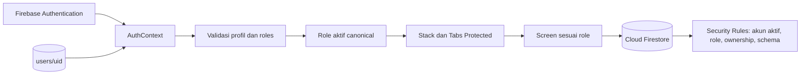

# Audit User Flow, Role, dan Auth — 24 November 2026

## Ruang Lingkup

Audit mencakup state autentikasi, skema profil, pemilihan role aktif, proteksi route, alur praktikan/asisten, serta otorisasi Firestore. Baseline audit adalah branch `fix/userflow` setelah dokumentasi sprint dirapikan.

## Ringkasan Kondisi Awal dan Target

| Area | Kondisi Aktual Saat Audit | Kondisi Ideal | Penyesuaian |
|---|---|---|---|
| Sumber role | `role`, `activeRole`, dan `peranAktif` tumpang tindih; deklarasi state auth terduplikasi. | Satu role aktif canonical yang selalu merupakan subset `roles`. | `AuthContext` menjadi sumber tunggal; `AppContext` hanya adapter kompatibilitas. |
| Validasi profil | Sesi Firebase dapat dianggap valid sebelum profil dan status akun diverifikasi. | Akses hanya setelah profil lengkap, role valid, dan akun aktif. | Domain validator menolak profil hilang/tidak lengkap/suspended dan mengakhiri sesi. |
| Auth route | Login/register dirender sebagai state komponen di root. | Login dan registrasi merupakan route publik eksplisit. | Ditambahkan `/login` dan `/register` dengan guard navigator. |
| Otorisasi UI | Guard tersebar per layar dan tab role yang tidak relevan tetap berpotensi muncul. | Struktur navigator mengikuti status auth dan role aktif. | `Stack.Protected` dan `Tabs.Protected` diterapkan terpusat. |
| Pergantian role | UI dapat berpindah mode tanpa kontrak kuat terhadap role akun. | Role hanya dapat dipilih dari `roles`, disimpan lokal, lalu navigasi dinormalisasi. | Header/profil memakai API `setActiveRole` canonical dan kembali ke dashboard. |
| Profil pengguna | Pengguna berpotensi mengirim field profil arbitrer melalui service update. | Client hanya boleh mengubah nama; identitas akademik, role, dan status administratif immutable. | Service dan Rules membatasi update ke `nama` serta `updatedAt`. |
| Registrasi | Status akun tidak menjadi bagian kontrak eksplisit. | Registrasi publik hanya membuat praktikan aktif. | `accountStatus` ditambahkan; role asisten tetap melalui provisioning tepercaya. |
| Sesi | Semua asisten berpotensi mengubah sesi asisten lain. | Mutasi sesi hanya oleh asisten pemilik, dengan transisi status valid. | Rules mengunci `asistenId`, timestamp, lab aktif, dan transisi buka/tutup. |
| Presensi | Identitas dan relasi kelas belum seluruhnya divalidasi pada boundary data. | Data harus cocok dengan profil, sesi, lab, GPS, radius, dan waktu server. | Rules memverifikasi identitas, kelas, session/lab, akurasi, umur lokasi, radius, dan ID deterministik. |
| Izin | ID acak memungkinkan pengajuan ganda; reviewer hanya disimpan sebagai nama. | Satu izin per sesi/pengguna dan reviewer dapat diaudit. | ID menjadi `${sessionId}_${uid}` serta menyimpan `reviewedByUid`. |
| Dokumentasi | Role, route, trust boundary, dan alur end-to-end tersebar. | Satu kontrak operasional yang dapat dipakai implementasi dan QA. | Ditambahkan `docs/USER_FLOWS_AND_AUTH.md` dan tautan README. |

## Temuan Risiko Utama

### Kritis

1. Duplikasi deklarasi `activeRole` menyebabkan source auth tidak dapat diparse dan memutus lint/typecheck.
2. State role ganda memungkinkan UI, route, dan otorisasi mengambil keputusan yang berbeda.
3. Route role-spesifik belum dilindungi secara struktural pada root navigator.

### Tinggi

1. Pengguna dapat mengirim perubahan profil yang terlalu luas dari client.
2. Pengajuan izin memakai ID acak sehingga duplikasi tidak dicegah pada boundary Firestore.
3. Kepemilikan sesi dan identitas reviewer belum cukup kuat untuk audit trail.

### Menengah

1. Halaman dashboard, header, profil, dan presensi memuat hasil merge dari dua implementasi berbeda.
2. Skema `accountStatus` belum tersedia untuk menonaktifkan akun tanpa menghapus Firebase Auth.
3. User flow role dan prosedur provisioning belum terdokumentasi sebagai kontrak.

## Arsitektur Hasil Penyesuaian

## Keputusan Desain

- `roles` pada Firestore adalah sumber hak akses; role aktif bukan hak akses baru.
- Preferensi role aktif disimpan pada perangkat agar pergantian role tidak memerlukan write administratif.
- `role` tetap dipertahankan sebagai canonical fallback untuk kompatibilitas data lama.
- Registrasi mandiri hanya untuk praktikan. Pemberian hak asisten dilakukan di luar client.
- UI guard meningkatkan pengalaman pengguna, sedangkan Firestore Rules menjadi enforcement boundary.
- Domain kelas/enrollment formal dan remote push notification tidak dimasukkan dalam remediasi ini karena memerlukan model data serta workflow administratif tersendiri.

## Acceptance Criteria

- Source auth dapat diparse dan seluruh unit test auth lulus.
- Akun suspended, profil tanpa identitas, profil praktikan tanpa kelas, atau profil tanpa role valid ditolak.
- Role aktif tidak dapat dipilih di luar `roles`.
- Route dan tab khusus role tidak tersedia bagi role lain.
- User hanya dapat mengubah nama profilnya sendiri.
- Presensi dan izin menggunakan dokumen deterministik dan hanya dapat dibuat pada sesi yang valid.
- Review izin mencatat UID asisten.
- Lint, TypeScript, Jest, Expo Doctor, dan pemeriksaan kompatibilitas Expo dijalankan sebelum handoff.

## Sisa Risiko dan Pekerjaan Lanjutan

1. Buat domain `classes` dan `enrollments` agar keanggotaan kelas/sesi tidak hanya bergantung pada string `kelas`.
2. Batasi query/list sesi praktikan berdasarkan enrollment; pada implementasi saat ini Rules sudah menolak presensi dan izin lintas kelas saat write, tetapi daftar sesi masih dapat memuat kelas lain.
3. Tambahkan Firebase Rules emulator test untuk skenario allow/deny lintas role sebelum deployment production.
4. Sediakan backend/admin console untuk provisioning asisten, suspensi akun, dan audit perubahan role.
5. Uji alur dua akun serta GPS pada perangkat fisik dan development build.
6. Implementasikan penyimpanan token dan trusted backend bila remote push notification dibutuhkan.

## Hasil Validasi

| Pemeriksaan | Hasil |
|---|---|
| `npm run validate` | Lulus: lint, TypeScript, 4 test suite, dan 12 unit test. |
| `npx expo-doctor` | Lulus 20/20 pemeriksaan. |
| `npx expo install --check` | Seluruh dependency kompatibel dengan Expo SDK 58. |
| `git diff --check` | Lulus; hanya terdapat peringatan normalisasi LF/CRLF dari Git di Windows. |
| Firebase Rules dry-run | Belum dapat dijalankan karena environment tidak memiliki Application Default Credentials. |
| Firebase Rules emulator | Belum dapat dijalankan karena Java lokal masih versi 8, sedangkan Firebase CLI memerlukan Java 21 atau lebih baru. |

Rules harus dikompilasi dan diuji pada emulator atau Firebase project terautentikasi sebelum deployment production.
