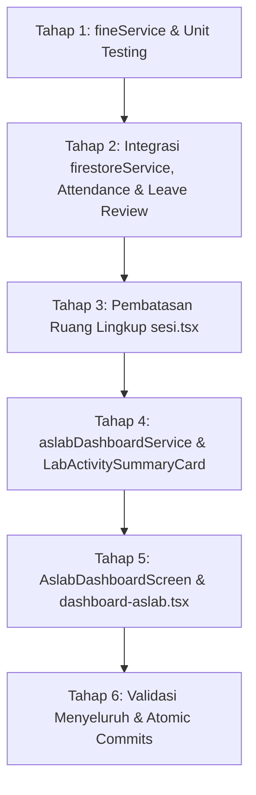

# Dokumen Rencana Implementasi Sprint 4 — Programmer 2 (P2)

* **PIC:** Aufaarel Nabiil Aryadh Mecca (`24060124140206`) / P2 Farrel
* **Branch Git:** `feature/aslab-dashboard-fines`
* **Cakupan SRS:** `SRS-FT-19`, `SRS-FT-20`, `SRS-FT-21`
* **Dokumen Acuan:** `TASK_SPRINT4_P2_FARREL.md`, `PRAKMOBILE4.md`, `USER_FLOWS_AND_AUTH.md`
* **Status:** Draft Perencanaan Disetujui (Pra-Pengerjaan)

---

## 1. Analisis Ruang Lingkup & Strict File Ownership (0% Conflict)

Sesuai arahan PM dan kontrak isolasi file antar-programmer pada Sprint 4, Programmer 2 **HANYA** memiliki hak akses dan modifikasi pada **10 berkas berikut**:

| No | Tipe | Path Berkas | Fungsi & Tanggung Jawab |
|---|:---:|---|---|
| 1 | `[NEW]` | `src/services/fineService.js` | Engine evaluasi *grace period*, pembuatan tagihan denda idempoten deterministik, listener real-time, dan agregasi finansial denda. |
| 2 | `[NEW]` | `src/services/aslabDashboardService.js` | Layanan kalkulasi & filter waktu (`hari`, `minggu`, `bulan`) serta agregasi metrik Dashboard Keberlangsungan Lab & Keuangan Aslab. |
| 3 | `[NEW]` | `src/components/aslab/LabActivitySummaryCard.js` | Komponen visual modular untuk KPI lab, praktikan, status kegiatan, dan ringkasan finansial (mengikuti tema dinamis & `Ionicons`). |
| 4 | `[NEW]` | `src/screens/aslab/AslabDashboardScreen.js` | Layanan tampilan antarmuka Dashboard Aslab lengkap dengan filter periode, 6 blok informasi wajib, dan shortcut aksi cepat. |
| 5 | `[NEW]` | `src/app/dashboard-aslab.tsx` | Route layar Dashboard Aslab di Expo Router, dibungkus `RoleRouteGuard` peran `aslab`. |
| 6 | `[MODIFY]` | `src/services/firestoreService.js` | Modifikasi `createSession` (warisi *grace period* & denda), helper `filterSessionsForAsprak`, dan `submitAttendance` (evaluasi keterlambatan & pemicu denda). |
| 7 | `[MODIFY]` | `src/app/sesi.tsx` | Membatasi tampilan sesi Asprak hanya pada lab tanggung jawabnya, menampilkan info kebijakan denda lab, serta badge ketepatan waktu. |
| 8 | `[MODIFY]` | `src/screens/praktikan/AttendanceCheckScreen.js` | Menampilkan kartu info batas *grace period* & nominal denda lab, serta umpan balik transparan jika presensi terlambat (+info pembayaran denda). |
| 9 | `[MODIFY]` | `src/screens/asisten/LeaveReviewScreen.js` | Menampilkan penjelasan bahwa izin yang disetujui berstatus *excused absence* (bebas denda & tidak mengubah kehadiran menjadi hadir). |
| 10 | `[NEW]` | `tests/fineCalculation.test.js` | Pengujian unit Jest mencakup 6 skenario inti perhitungan waktu, idempotensi denda, aturan bisnis, dan filter periode dashboard. |

> **Larangan Keras:**
> - Dilarang menyentuh file milik P1 (Azlan: `src/types/index.ts`, `src/domain/auth.ts`, `labService.js`, `firestore.rules`, dll.).
> - Dilarang menyentuh file milik P3 (Marchella: `backend/`, `paymentService.js`, `notificationService.js`, `_layout.tsx`, `(tabs)/*`).
> - Dilarang mengubah root `package.json` / `package-lock.json` (zero new native packages).

---

## 2. Rincian Kebutuhan Sistem & User Story (SRS)

### A. SRS-FT-21: Engine Keterlambatan (Grace Period) & Pengelolaan Denda Idempoten
* **User Story:** Sebagai sistem dan praktikan, saya ingin keterlambatan dihitung otomatis menggunakan *grace period* terhadap waktu mulai sesi sehingga menghasilkan tepat satu tagihan denda nominal tetap tanpa mengubah status kehadiran saat dibayar, serta memastikan izin yang disetujui Asprak berstatus *excused absence* dan bebas denda.
* **Logika Perhitungan (*Pure Math*):**
  $$\text{deadlineMs} = \text{startMs} + (\text{gracePeriodMinutes} \times 60.000)$$
  - Jika $\text{attendanceMs} \le \text{deadlineMs}$: **Tepat Waktu** (`isLate: false`, `lateMinutes: 0`, `attendancePunctuality: 'ON_TIME'`).
  - *Edge Case Wajib:* Presensi tepat pada menit ke-$\text{gracePeriod}$ ($\text{attendanceMs} == \text{deadlineMs}$) adalah **TEPAT WAKTU**.
  - Jika $\text{attendanceMs} > \text{deadlineMs}$: **Terlambat** (`isLate: true`, `lateMinutes: Math.max(1, Math.ceil((attendanceMs - deadlineMs) / 60000))`, `attendancePunctuality: 'LATE'`).
* **Proteksi Idempotensi Denda:**
  - ID Dokumen Deterministik: `fineId = `${sessionId}_${studentId}`` pada koleksi `fines`.
  - Cek terlebih dahulu via `getDoc(doc(db, 'fines', fineId))`. Jika sudah ada, jangan buat duplikat.
  - Cek `leave_requests/${sessionId}_${studentId}`. Jika status `approved`, denda **ditiadakan** (`excused: true`).
  - Nominal denda diwarisi dari `session.lateFineAmount` atau default `10000`.
  - Status pembayaran awal: `'pending'`.
  - **Prinsip Penting:** Pembayaran denda **TIDAK PERNAH** mengubah `statusKehadiran` (tetap `'HADIR'`).

### B. SRS-FT-20: Pengelolaan Sesi Terfokus Asprak
* **User Story:** Sebagai Asprak, saya ingin mengelola kelas, jadwal, pembukaan/penutupan sesi, dan pemantauan presensi khusus pada laboratorium yang menjadi tanggung jawab saya secara real-time tanpa mengakses konfigurasi seluruh laboratorium.
* **Filter Sesi Asprak (`filterSessionsForAsprak`):**
  - Asprak hanya melihat sesi dari lab yang mana UID Asprak terdaftar dalam `lab.asprakIds` atau `session.asistenId === asprakUid`.
* **Di Layar `sesi.tsx`:**
  - Menampilkan label penugasan lab Asprak, menyembunyikan aksi konfigurasi/edit lab (yang merupakan wewenang Aslab).
  - Menampilkan informasi kebijakan *Grace Period* dan *Nominal Denda* pada saat pembukaan sesi.
  - Menampilkan badge **TEPAT WAKTU** / **TERLAMBAT (+X mnt)** pada riwayat/rekap sesi.

### C. SRS-FT-19: Dashboard Keberlangsungan Laboratorium & Keuangan Denda Aslab
* **User Story:** Sebagai Aslab, saya ingin memantau dashboard keberlangsungan laboratorium dengan filter hari, minggu, dan bulan yang menampilkan jumlah lab dan praktikan, status tiap lab, lokasi dan waktu, jadwal berlangsung dan mendatang, riwayat kegiatan, serta riwayat keuangan hasil denda praktikum.
* **Fitur Filter Waktu (`hari`, `minggu`, `bulan`):**
  - `hari`: Tanggal lokal sama dengan hari ini.
  - `minggu`: 7 hari terakhir / pekan berjalan.
  - `bulan`: Bulan dan tahun berjalan.
* **6 Blok Informasi Wajib:**
  1. KPI: Total Laboratorium Aktif & Total Praktikan Terdaftar.
  2. Status Kegiatan Tiap Lab (`BERLANGSUNG`, `TERJADWAL`, `IDLE`) beserta info lokasi dan jam.
  3. Jadwal Praktikum Sedang Berlangsung & Akan Datang.
  4. Riwayat Kegiatan Praktikum Selesai (terfilter periode).
  5. Riwayat Keuangan Hasil Denda (Total Terkumpul `success`, Menunggu `pending`, Gagal `failed`, beserta daftar transaksi denda terfilter).
  6. Menu Pintasan Cepat Aslab ke `/lokasi-lab`, `/bulk-insert`, dan `/transfer-lab`.

---

## 3. Desain Skema Data Firestore Terkait

### Koleksi `fines/{sessionId}_{studentId}`
```json
{
  "id": "{sessionId}_{studentId}",
  "attendanceId": "{sessionId}_{studentId}",
  "sessionId": "session-123",
  "sessionName": "Praktikum Pemrograman Perangkat Bergerak",
  "labId": "lab-rpl-1",
  "labName": "Laboratorium RPL 1",
  "studentId": "uid-praktikan",
  "studentName": "Ahmad Fauzi",
  "studentNim": "24060124120001",
  "studentClass": "TI-3A",
  "lateMinutes": 12,
  "gracePeriodMinutes": 15,
  "amount": 10000,
  "paymentStatus": "pending",
  "latestOrderId": null,
  "latestInvoiceId": null,
  "latestInvoiceUrl": null,
  "paidAt": null,
  "createdAt": "Timestamp",
  "updatedAt": "Timestamp"
}
```

### Tambahan Field pada `sessions/{sessionId}`
* `gracePeriodMinutes`: `number` (default `15`)
* `lateFineAmount`: `number` (default `10000`)

### Tambahan Field pada `attendances/{sessionId}_{studentId}`
* `isLate`: `boolean`
* `lateMinutes`: `number`
* `attendancePunctuality`: `'ON_TIME' | 'LATE'`
* `statusKehadiran`: `'HADIR'` (tidak berubah karena denda)

---

## 4. Tahapan Rencana Eksekusi (Phase Plan)



### Tahap 1: Core Engine Keterlambatan & Unit Tests
1. Membuat `src/services/fineService.js`:
   - `evaluateAttendanceLateness`
   - `createLateFineIfNeeded`
   - `subscribeStudentFines`
   - `subscribeAllFines`
   - `summarizeFineFinances`
2. Membuat `tests/fineCalculation.test.js`:
   - Uji batas tepat, sebelum, dan sesudah *grace period*.
   - Uji durasi kustom (10 mnt vs 30 mnt).
   - Uji agregasi keuangan denda.
   - Uji aturan bisnis izin (*excused absence*).

### Tahap 2: Integrasi Presensi & Review Izin
1. Memodifikasi `src/services/firestoreService.js`:
   - `createSession`: tambahkan pewarisan `gracePeriodMinutes` dan `lateFineAmount`.
   - `filterSessionsForAsprak`: filter sesi berbasis `lab.asprakIds` dan `session.asistenId`.
   - `submitAttendance`: panggil evaluasi keterlambatan, simpan status `isLate`, dan buat denda idempoten jika terlambat.
2. Memodifikasi `src/screens/praktikan/AttendanceCheckScreen.js`:
   - Kartu info batas *grace period* & nominal denda.
   - Umpan balik transparan ketepatan waktu / tagihan denda dibuat.
3. Memodifikasi `src/screens/asisten/LeaveReviewScreen.js`:
   - Penegasan teks *excused absence* (bebas denda & tidak mengubah kehadiran).

### Tahap 3: Pemfokusan Layar Sesi Asprak (`src/app/sesi.tsx`)
1. Mengaplikasikan `filterSessionsForAsprak` pada tampilan sesi Asprak.
2. Menampilkan informasi *Grace Period* dan *Denda* saat membuka sesi.
3. Menampilkan badge `TEPAT WAKTU` (hijau) atau `TERLAMBAT` (amber) pada baris rekap kehadiran.

### Tahap 4 & 5: Dashboard Aslab & Komponen Agregasi
1. Membuat `src/services/aslabDashboardService.js`:
   - Fungsi murni `filterByPeriod(items, period, dateExtractor)`.
   - Agregator `buildAslabDashboardMetrics({ labs, sessions, attendances, fines, period })`.
2. Membuat `src/components/aslab/LabActivitySummaryCard.js`:
   - Kartu KPI, status per lab, dan ringkasan finansial denda dengan tema dinamis & `Ionicons`.
3. Membuat `src/screens/aslab/AslabDashboardScreen.js` & `src/app/dashboard-aslab.tsx`:
   - SegmentedControl filter periode: `Hari`, `Minggu`, `Bulan`.
   - 6 blok informasi wajib dashboard keberlangsungan lab & keuangan.
   - Route guard proteksi peran `aslab`.

### Tahap 6: Validasi Kualitas & Atomic Commits
1. Menjalankan:
   ```bash
   npm run validate
   # Memastikan: lint lolos, tsc --noEmit 0 error, jest lolos
   ```
2. Commit sesuai format Conventional Commit Bahasa Indonesia (Head & Body, tanpa Co-Author).

---

## 5. Rencana Atomic Commits

1. **Commit 1:**
   ```text
   feat(fines): buat engine perhitungan grace period dan pengelolaan tagihan denda idempoten

   Mengimplementasikan evaluateAttendanceLateness dengan presisi batas toleransi,
   pembuatan dokumen fines deterministic ID, pengecekan excused absence,
   serta listener real-time dan agregasi finansial denda.
   ```

2. **Commit 2:**
   ```text
   feat(attendance): integrasikan evaluasi keterlambatan dan pembatasan ruang lingkup sesi asprak

   Menghubungkan evaluasi keterlambatan pada submitAttendance di firestoreService,
   menampilkan info toleransi dan denda pada AttendanceCheckScreen, memastikan
   izin berstatus excused absence di LeaveReviewScreen, serta memfilter sesi asprak
   khusus lab binaan di sesi.tsx dengan badge ketepatan waktu.
   ```

3. **Commit 3:**
   ```text
   feat(aslab): tambahkan layanan agregasi dan dashboard keberlangsungan lab serta keuangan denda

   Menyediakan fungsi kalkulasi metrik dengan filter hari, minggu, bulan pada
   aslabDashboardService, komponen LabActivitySummaryCard, layar interaktif
   AslabDashboardScreen, dan rute navigasi dashboard-aslab terproteksi peran aslab.
   ```

4. **Commit 4:**
   ```text
   test(fines): tambahkan unit test perhitungan grace period, denda, dan filter dashboard aslab

   Menambahkan pengujian Jest untuk skenario presensi tepat waktu, presensi tepat
   pada batas akhir toleransi, keterlambatan, kustomisasi durasi, agregasi finansial,
   dan verifikasi aturan bisnis bebas denda bagi izin disetujui.
   ```

---

## 6. Prosedur Merge Gelombang 2
* P2 menunggu PR P1 (Azlan) di-merge ke `main`.
* P2 melakukan `git pull origin main` ke branch `feature/aslab-dashboard-fines`.
* Jalankan `npm run validate` kembali untuk memastikan integrasi 100% mulus sebelum membuka PR ke `main`.
