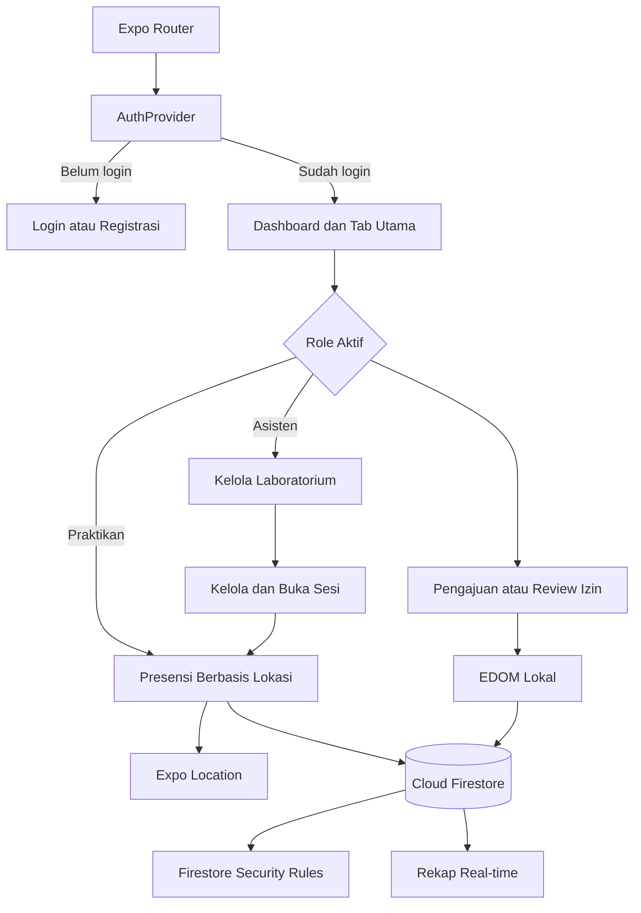
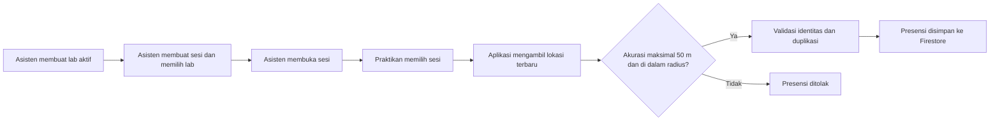

# Presensi Praktikum Mobile

Aplikasi presensi laboratorium berbasis React Native dan Expo SDK 58. Sistem mengintegrasikan autentikasi Firebase, pengelolaan laboratorium dan sesi praktikum, presensi berbasis lokasi, rekap real-time, pengajuan izin, serta analisis sentimen lokal EDOM.

## Daftar Isi

- [Ringkasan](#ringkasan)
- [Peran Pengguna](#peran-pengguna)
- [Fitur per Sprint](#fitur-per-sprint)
- [Arsitektur dan Alur Utama](#arsitektur-dan-alur-utama)
- [Teknologi](#teknologi)
- [Struktur Proyek](#struktur-proyek)
- [Konfigurasi Environment](#konfigurasi-environment)
- [Menjalankan Proyek](#menjalankan-proyek)
- [Validasi](#validasi)
- [Firebase dan EAS](#firebase-dan-eas)
- [Batasan Implementasi](#batasan-implementasi)
- [Dokumentasi Proyek](#dokumentasi-proyek)

## Ringkasan

Aplikasi dikembangkan dalam tiga sprint:

1. **Sprint 1 — Antarmuka dan alur dasar:** navigasi utama, jadwal sesi, presensi, rekap, profil, dan sistem tema.
2. **Sprint 2 — Firebase dan AI:** autentikasi, sinkronisasi Firestore, pengajuan izin, review asisten, dan klasifikasi sentimen EDOM.
3. **Sprint 3 — Lokasi dan perangkat:** presensi berbasis radius, pengelolaan lokasi laboratorium, peta interaktif, permission perangkat, dan fondasi notifikasi.

Data produksi aplikasi menggunakan Firebase Authentication dan Cloud Firestore. Identitas pengguna berasal dari dokumen `users/{uid}`, sedangkan role aktif hanya dapat dipilih dari role yang telah diberikan kepada akun tersebut.

## Peran Pengguna

| Peran | Akses Utama |
|---|---|
| Praktikan | Melihat sesi, melakukan presensi berbasis lokasi, mengajukan izin, melihat status izin, dan membuka peta laboratorium. |
| Asisten | Mengelola laboratorium dan sesi, membuka atau menutup sesi, melihat rekap kehadiran, serta memproses pengajuan izin. |

Dokumen pengguna mendukung satu atau beberapa role resmi:

```json
{
  "role": "praktikan",
  "roles": ["praktikan", "asisten"]
}
```

Field `roles` harus diprovisikan melalui Firebase Console atau backend administratif tepercaya. Pengguna tidak dapat menambahkan role miliknya sendiri melalui aplikasi.

## Fitur per Sprint

Status pada tabel menunjukkan cakupan implementasi fitur, bukan hasil acceptance test production.

### Sprint 1 — Antarmuka dan Alur Dasar

| Modul | Fitur | Peran | Implementasi | Status | Berkas Utama |
|---|---|---|---|---|---|
| S1-01 | Dashboard dan jadwal sesi | Praktikan, Asisten | Menampilkan daftar sesi dan pintasan menu sesuai role aktif. | Tersedia | `src/app/(tabs)/index.tsx` |
| S1-02 | Navigasi tab | Praktikan, Asisten | Navigasi Jadwal, Presensi, Rekap, dan Profil menggunakan Expo Router. | Tersedia | `src/app/(tabs)/_layout.tsx` |
| S1-03 | Presensi | Praktikan | Menyediakan pintasan menuju alur presensi resmi berbasis lokasi. | Tersedia | `src/app/(tabs)/presensi.tsx` |
| S1-04 | Rekap kehadiran | Asisten | Memilih sesi dan memantau daftar serta statistik presensi secara real-time. | Tersedia | `src/app/(tabs)/rekap.tsx`, `src/features/rekap/RekapPresensiView.tsx` |
| S1-05 | Profil dan preferensi | Praktikan, Asisten | Menampilkan identitas Firebase, role yang tersedia, tema, dan aksi logout. | Tersedia | `src/app/(tabs)/profil.tsx` |
| S1-06 | Design system | Praktikan, Asisten | Tema terang/gelap, container layar, kartu, badge, empty state, dan segmented control. | Tersedia | `src/theme/index.ts`, `src/components/` |

### Sprint 2 — Firebase, Presensi Real-time, dan AI

| Kode SRS | Fitur | Peran | Implementasi | Status | Berkas Utama |
|---|---|---|---|---|---|
| FT-01 | Autentikasi pengguna | Praktikan, Asisten | Registrasi praktikan, login, logout, persistence sesi, dan profil Firestore. | Tersedia | `src/services/authService.js`, `src/context/AuthContext.js` |
| FT-02 | Pengelolaan sesi | Asisten | CRUD sesi, pemilihan laboratorium, serta kontrol buka/tutup sesi. Domain kelas terpisah belum lengkap. | Parsial | `src/app/sesi.tsx`, `src/services/firestoreService.js` |
| FT-03 | Presensi satu kali | Praktikan | ID dokumen deterministik `${sessionId}_${studentId}` dan validasi duplikasi di client serta Rules. | Tersedia | `src/services/firestoreService.js`, `firestore.rules` |
| FT-04 | Sinkronisasi real-time | Praktikan, Asisten | Listener Firestore untuk sesi, presensi pengguna, dan rekap sesi. | Tersedia | `src/hooks/useAttendance.js`, `src/services/firestoreService.js` |
| FT-05 | Pengajuan izin | Praktikan | Memilih sesi aktif, mengisi alasan, dan menyimpan pengajuan berstatus `pending`. | Tersedia | `src/screens/praktikan/LeaveRequestScreen.js`, `src/services/permissionService.js` |
| FT-06 | Analisis sentimen EDOM | Praktikan, Asisten | Inferensi LinearSVC lokal dengan label positif, netral, atau negatif. | Eksperimental | `ai/model-edom.json`, `ai/sentiment.js`, `src/services/aiService.js` |
| FT-07 | Review izin | Praktikan, Asisten | Review transaksional menjadi `approved` atau `rejected` dan pemantauan status real-time. | Tersedia | `src/screens/asisten/LeaveReviewScreen.js`, `src/screens/praktikan/LeaveStatusScreen.js` |
| FT-08 | Validasi dan keamanan | Praktikan, Asisten | Role guard, validasi input, Firestore Security Rules, serta composite indexes. | Parsial | `src/components/navigation/RoleRouteGuard.tsx`, `firestore.rules`, `firestore.indexes.json` |

### Sprint 3 — Lokasi, Peta, dan Kondisi Perangkat

| Kode SRS | Fitur | Peran | Implementasi | Status | Berkas Utama |
|---|---|---|---|---|---|
| FT-09 | Halaman presensi khusus | Praktikan | Pemilihan sesi, status sesi, status lokasi, dan status presensi pengguna. | Tersedia | `src/screens/praktikan/AttendanceCheckScreen.js` |
| FT-10 | Validasi lokasi dan radius | Praktikan | GPS berakurasi maksimal 50 meter, perhitungan Haversine, validasi radius, lokasi kedaluwarsa, dan anti-duplikasi. | Tersedia | `src/services/locationService.js`, `src/services/firestoreService.js`, `firestore.rules` |
| FT-11 | Pengelolaan lokasi lab | Asisten | Tambah, ubah, aktifkan, dan nonaktifkan laboratorium beserta koordinat dan radius. | Tersedia | `src/screens/asisten/LabLocationManageScreen.js`, `src/services/labService.js` |
| FT-12 | Peta laboratorium | Praktikan, Asisten | Marker lab, lokasi pengguna, jarak ke lab, serta sesi berlangsung dan berikutnya. | Tersedia | `src/screens/maps/LabMapScreen.js`, `src/components/maps/LabActivitySheet.js` |
| FT-13 | Notifikasi kegiatan | Praktikan, Asisten | Android notification channel, permission, push token retrieval, dan local notification helper. Pengiriman remote belum tersedia. | Parsial | `src/services/notificationService.js` |
| FT-14 | Permission dan kondisi perangkat | Praktikan, Asisten | Status izin lokasi/notifikasi, GPS, koneksi, location watcher, dan banner pemulihan. | Tersedia | `src/hooks/useDevicePermissionsAndAlerts.js`, `src/components/common/DeviceConditionBanner.js` |

## Arsitektur dan Alur Utama



### Alur Presensi Berbasis Lokasi



### Alur Pengajuan Izin

1. Praktikan memilih sesi terbuka dan menulis alasan izin.
2. Model EDOM menganalisis alasan secara lokal.
3. Pengajuan disimpan ke `leave_requests` dengan status `pending`.
4. Asisten meninjau alasan dan label AI sebagai informasi pendukung.
5. Keputusan disimpan secara transaksional sebagai `approved` atau `rejected`.
6. Praktikan menerima pembaruan status melalui listener Firestore.

Hasil AI bersifat eksperimental dan tidak digunakan sebagai keputusan otomatis.

## Teknologi

| Teknologi | Kegunaan |
|---|---|
| Expo SDK 58 | Runtime, tooling, development client, dan integrasi native. |
| React Native 0.88 | Antarmuka mobile lintas platform. |
| React 19 | Komponen dan state UI. |
| TypeScript dan JavaScript | Implementasi aplikasi. |
| Expo Router | File-based routing dan navigasi. |
| Firebase Authentication | Autentikasi email/password. |
| Cloud Firestore | Penyimpanan dan sinkronisasi data real-time. |
| Firebase Security Rules | Otorisasi dan validasi data. |
| Expo Location | Permission, koordinat, dan akurasi GPS. |
| react-native-maps | Peta dan marker native. |
| Expo Notifications | Permission, channel Android, token, dan notifikasi lokal. |
| Jest | Unit test service dan domain. |
| EAS Build dan Update | Build cloud serta pembaruan aplikasi. |

## Struktur Proyek

```text
ppk-mobile-praktikum/
|-- ai/                         # Model dan inference EDOM
|-- assets/                     # Ikon, splash screen, dan aset aplikasi
|-- scripts/                    # Migrasi role dan audit relasi sesi-lab
|-- src/
|   |-- app/                    # Route dan layout Expo Router
|   |-- components/             # Komponen UI bersama
|   |-- config/                 # Konfigurasi Firebase
|   |-- context/                # AuthContext dan AppContext
|   |-- features/               # Modul fitur terkomposisi
|   |-- hooks/                  # Hook presensi dan kondisi perangkat
|   |-- screens/                # Screen autentikasi, asisten, praktikan, dan peta
|   |-- services/               # Firebase, lokasi, notifikasi, izin, dan AI
|   |-- theme/                  # Token tema terang dan gelap
|   `-- types/                  # Kontrak tipe domain
|-- tests/                      # Unit test Jest
|-- app.json                    # Konfigurasi Expo dan config plugins
|-- eas.json                    # Profil EAS Build
|-- firebase.json               # Konfigurasi deployment Firebase
|-- firestore.rules             # Firestore Security Rules
|-- firestore.indexes.json      # Composite indexes Firestore
`-- package.json                # Dependency dan script proyek
```

## Konfigurasi Environment

Salin `.env.example` menjadi `.env`, lalu isi Firebase Web Client Configuration:

```dotenv
EXPO_PUBLIC_FIREBASE_API_KEY=
EXPO_PUBLIC_FIREBASE_AUTH_DOMAIN=
EXPO_PUBLIC_FIREBASE_PROJECT_ID=
EXPO_PUBLIC_FIREBASE_STORAGE_BUCKET=
EXPO_PUBLIC_FIREBASE_MESSAGING_SENDER_ID=
EXPO_PUBLIC_FIREBASE_APP_ID=
EXPO_PUBLIC_FIREBASE_MEASUREMENT_ID=
```

Konfigurasi client Firebase bukan kredensial server. Keamanan data tetap bergantung pada Authentication, Firestore Security Rules, dan pembatasan akses project.

## Menjalankan Proyek

Proyek menggunakan npm karena memiliki `package-lock.json`.

```bash
npm install
npm run start:dev
```

Perintah pengembangan lain:

```bash
npm run start            # Metro standar
npm run start:dev:clear  # Development client dengan cache bersih
npm run start:tunnel     # Development client melalui tunnel
npm run web              # Menjalankan versi web
```

Expo Go tidak memuat seluruh native module yang digunakan proyek. Gunakan development build untuk menguji Maps dan Notifications secara penuh.

## Validasi

Jalankan quality gate sebelum membuat commit atau build:

```bash
npm run validate
npx expo-doctor
npx expo install --check
```

`npm run validate` menjalankan lint, TypeScript typecheck, dan test Jest secara berurutan.

Perintah individual:

```bash
npm run lint
npx tsc --noEmit
npm test
```

## Firebase dan EAS

### Deploy Firestore Rules dan Indexes

```bash
npx firebase-tools deploy --only firestore:rules,firestore:indexes
```

### Migrasi Role Lama

Gunakan Application Default Credentials atau service account administratif. Periksa dry-run sebelum menerapkan perubahan:

```bash
npm run migrate:user-roles
npm run migrate:user-roles -- --apply
```

Audit relasi sesi dan laboratorium tidak melakukan perubahan data:

```bash
npm run audit:session-labs
```

### Development Build Android

Perubahan config plugin atau native dependency memerlukan build baru:

```bash
npx eas-cli@latest build --profile development --platform android
```

### Preview Build Android

```bash
npx eas-cli@latest build --profile preview --platform android
```

Konfigurasi profil build tersedia pada `eas.json`.

## Batasan Implementasi

- Push notification belum dikirim end-to-end ke perangkat pengguna lain. Repository baru menyediakan permission, channel Android, token retrieval, listener, dan local notification helper. Remote delivery masih memerlukan penyimpanan token serta backend tepercaya.
- Rules dan indexes pada repository baru aktif setelah dideploy ke project Firebase target.
- Validasi GPS mengurangi input lokasi buruk, tetapi tidak menjamin perangkat bebas dari location spoofing.
- Model EDOM merupakan baseline penelitian dan belum divalidasi khusus untuk alasan izin praktikum.
- Pengujian Maps, GPS, notification delivery, dan alur dua akun tetap memerlukan perangkat fisik.
- Advisory dependency tidak boleh ditangani menggunakan `npm audit fix --force` jika perbaikannya menurunkan versi utama Expo atau Firebase.

## Dokumentasi Proyek

| Dokumen | Isi |
|---|---|
| [PRAKMOBILE1.md](./PRAKMOBILE1.md) | Analisis kebutuhan, domain, dan pembagian tugas Sprint 1. |
| [PRAKMOBILE2.md](./PRAKMOBILE2.md) | SRS dan rancangan implementasi Sprint 2. |
| [PRAKMOBILE3.md](./PRAKMOBILE3.md) | SRS lokasi, peta, notifikasi, dan pembagian tugas Sprint 3. |
| [AUDITSYS19NOV.md](./AUDITSYS19NOV.md) | Audit teknis, addendum, hasil remediasi, dan langkah aktivasi environment. |
| [AGENTS.md](./AGENTS.md) | Aturan kontribusi dan workflow repository. |

## Lisensi

Proyek menggunakan lisensi yang tercantum pada [LICENSE](./LICENSE).
