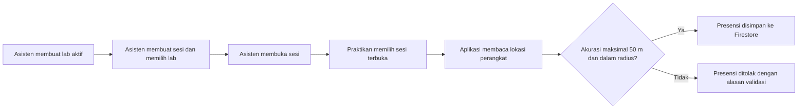

# Presensi Praktikum Mobile - React Native

Aplikasi presensi laboratorium untuk Praktikum Pengembangan Perangkat Bergerak (PPK) berbasis React Native menggunakan Expo SDK 58, TypeScript, Expo Router, dan Firebase.

Dokumentasi analisis kebutuhan dan pembagian tugas paralel untuk 3 pemrogram tercantum pada berkas [PRAKMOBILE1.md](./PRAKMOBILE1.md).

---

## 1. Ringkasan Aplikasi

Aplikasi dikembangkan secara bertahap melalui dua sprint:

- **Sprint 1:** Implementasi fitur dasar presensi praktikum.
- **Sprint 2:** Pengembangan autentikasi, penyimpanan data berbasis Firebase, pengajuan izin, dan integrasi klasifikasi sentimen AI EDOM.

Aplikasi memiliki dua peran utama, yaitu **Asisten Praktikum** dan **Praktikan**, dengan hak akses dan fitur yang disesuaikan berdasarkan perannya.

### 1.1 Modul Sprint 1

Aplikasi menyediakan empat tab navigasi utama:

| Tab Navigasi | Berkas Sumber | Penanggung Jawab | Deskripsi Fungsional |
|---|---|---|---|
| Jadwal Sesi | `src/app/(tabs)/index.tsx` | Pemrogram 1 | Pemantauan jadwal dan siklus sesi praktikum, termasuk pembukaan dan penutupan sesi oleh Asisten. |
| Presensi | `src/app/(tabs)/presensi.tsx` | Pemrogram 2 | Pencatatan kehadiran mahasiswa dengan validasi anti-duplikasi dan riwayat presensi pribadi. |
| Rekapitulasi | `src/app/(tabs)/rekap.tsx` | Pemrogram 3 | Rekapitulasi kehadiran praktikan per sesi, catatan waktu presensi, dan statistik kehadiran. |
| Profil | `src/app/(tabs)/profil.tsx` | Pemrogram 3 | Informasi identitas pengguna, pengalih peran, dan ringkasan aplikasi. |

### 1.2 Pengembangan Sprint 2

Sprint 2 berfokus pada pengembangan autentikasi, pengelolaan pengajuan izin, serta penerapan AI untuk membantu analisis sentimen.

| Kode SRS | Fitur | Deskripsi |
|---|---|---|
| FT-01 | Autentikasi Pengguna | Pengguna melakukan autentikasi menggunakan Firebase Authentication. |
| FT-05 | Pengajuan Izin Praktikan | Praktikan dapat mengirim pengajuan izin yang disimpan pada Cloud Firestore. |
| FT-06 | Analisis Sentimen AI EDOM | Sistem menganalisis teks alasan izin menggunakan model klasifikasi sentimen lokal. |
| FT-07 | Pemeriksaan Status Izin | Asisten dapat menyetujui atau menolak pengajuan, sedangkan Praktikan dapat melihat status pengajuannya. |
| FT-08 | Pengamanan Hak Akses | Akses fitur disesuaikan dengan peran pengguna dan dilindungi melalui aturan keamanan Firebase. |

### 1.3 Alur Pengajuan Izin

1. Praktikan masuk ke aplikasi menggunakan akun yang telah terautentikasi.
2. Praktikan mengisi formulir pengajuan izin dengan memilih sesi praktikum dan menuliskan alasan izin.
3. Sistem melakukan analisis sentimen terhadap teks alasan menggunakan AI EDOM.
4. Data pengajuan beserta hasil analisis AI disimpan ke Cloud Firestore dengan status awal `pending`.
5. Asisten melihat daftar pengajuan izin yang masuk.
6. Asisten memeriksa alasan dan hasil analisis sentimen sebagai informasi pendukung.
7. Asisten memberikan keputusan berupa `approved` atau `rejected`.
8. Status dan informasi keputusan tersimpan di Firestore dan dapat dipantau oleh Praktikan.

### 1.4 Teknologi yang Digunakan

| Teknologi | Kegunaan |
|---|---|
| React Native | Pengembangan antarmuka aplikasi mobile. |
| Expo | Lingkungan pengembangan dan pengujian aplikasi. |
| TypeScript / JavaScript | Bahasa pemrograman aplikasi. |
| Expo Router | Pengelolaan navigasi aplikasi. |
| Firebase Authentication | Autentikasi pengguna. |
| Cloud Firestore | Penyimpanan data pengajuan izin dan informasi terkait. |
| Firebase Security Rules | Pengaturan hak akses terhadap data Firebase. |
| JavaScript | Implementasi pemrosesan model AI lokal. |
| EAS Build | Proses build aplikasi Android dan iOS. |
| EAS Update | Distribusi pembaruan aplikasi secara nirkabel. |

---

## 2. Integrasi Firebase

Firebase digunakan untuk mendukung autentikasi dan penyimpanan data aplikasi.

### 2.1 Firebase Authentication

Firebase Authentication digunakan untuk mengelola proses autentikasi pengguna. Informasi autentikasi pengguna digunakan untuk mengidentifikasi akun yang sedang aktif.

Akses aplikasi dibedakan berdasarkan peran:

- **Praktikan:** Mengakses fitur presensi, pengajuan izin, dan pemantauan status pengajuan.
- **Asisten:** Mengakses fitur pengelolaan sesi, rekapitulasi, serta pemeriksaan pengajuan izin.

### 2.2 Cloud Firestore

Cloud Firestore digunakan untuk menyimpan data pengajuan izin pada koleksi:

`leave_requests`

Status pengajuan izin:

- `pending`: Menunggu pemeriksaan Asisten.
- `approved`: Pengajuan disetujui.
- `rejected`: Pengajuan ditolak.

Keputusan Asisten diproses menggunakan Firestore Transaction untuk memastikan pengajuan yang sudah diputuskan tidak diproses kembali.

### 2.3 Firebase Security Rules

Aturan keamanan Firestore digunakan untuk membatasi akses data berdasarkan identitas dan peran pengguna.

Secara umum:
- Praktikan hanya dapat membaca pengajuan miliknya.
- Praktikan hanya dapat membuat pengajuan dengan identitas akun yang sedang digunakan dan status awal `pending`.
- Asisten dapat memantau pengajuan dan memberikan keputusan.
- Perubahan status dan informasi pemeriksaan dibatasi sesuai aturan keamanan yang diterapkan.

Pastikan aturan keamanan yang digunakan sudah dipublikasikan melalui Firebase Console.

Deploy Rules dan composite index dari repository:

```bash
npx firebase-tools deploy --only firestore:rules,firestore:indexes
```

### 2.4 Alur Laboratorium, Sesi, dan Presensi

Laboratorium, sesi, dan presensi menggunakan sumber data Firestore yang sama. Asisten tidak dapat membuka sesi tanpa laboratorium aktif yang memiliki koordinat valid. Praktikan hanya dapat melakukan presensi pada sesi terbuka yang menunjuk laboratorium tersebut.



Urutan operasional:

1. Akun asisten membuka **Kelola Lab** dan membuat laboratorium beserta latitude, longitude, dan radius.
2. Asisten membuka **Kelola Sesi**, membuat sesi, lalu memilih laboratorium aktif.
3. Asisten membuka sesi. Nama dan lokasi laboratorium selalu diambil dari referensi `labId`, bukan input bebas.
4. Praktikan membuka satu menu **Presensi Lokasi**, memilih sesi terbuka, lalu memperbarui lokasi.
5. Sistem memvalidasi role, identitas profil, akurasi GPS, radius, serta duplikasi sebelum menyimpan presensi.

### 2.5 Role dan Identitas Akun

Identitas nama, email, NIM/NIP, dan kelas selalu berasal dari dokumen pengguna Firebase yang sama. Perpindahan mode tidak lagi mengganti identitas menjadi data dummy.

Contoh field role pada dokumen `users/{uid}`:

```json
{
  "role": "praktikan",
  "roles": ["praktikan", "asisten"]
}
```

- Akun satu role menggunakan `roles: ["praktikan"]` atau `roles: ["asisten"]`.
- Tombol ganti mode hanya muncul bila `roles` memuat kedua role.
- Field `roles` harus diprovisikan oleh administrator tepercaya melalui Firebase Console atau backend administratif. Firestore Rules melarang pengguna menaikkan role miliknya sendiri.

Untuk environment yang sudah memiliki profil lama, gunakan Application Default Credentials atau service account administratif, lalu jalankan migrasi dalam mode dry-run:

```bash
npm run migrate:user-roles
npm run migrate:user-roles -- --apply
```

Perintah kedua melakukan perubahan dan hanya boleh dijalankan setelah hasil dry-run diperiksa. Audit relasi seluruh sesi dan laboratorium bersifat read-only:

```bash
npm run audit:session-labs
```

---

## 3. Integrasi AI EDOM

AI EDOM digunakan untuk melakukan klasifikasi sentimen terhadap teks alasan pengajuan izin.

### 3.1 Mekanisme Analisis

1. Praktikan mengisi alasan izin.
2. Sistem mengirim teks ke fungsi `analyzeSentiment()`.
3. Model lokal melakukan pemrosesan teks dan klasifikasi sentimen.
4. Sistem menghasilkan kategori sentimen.
5. Hasil analisis disimpan bersama data pengajuan di Cloud Firestore.
6. Hasil klasifikasi ditampilkan melalui komponen `AIBadge`.

### 3.2 Kategori Sentimen

| Kategori | Keterangan |
|---|---|
| Positif | Teks memiliki kecenderungan sentimen positif. |
| Netral | Teks memiliki kecenderungan sentimen netral. |
| Negatif | Teks memiliki kecenderungan sentimen negatif. |
| Perlu Verifikasi Manual | Analisis tidak menghasilkan kategori yang dapat digunakan. |

### 3.3 Karakteristik Model

- Model dijalankan secara lokal menggunakan JavaScript.
- Tidak memerlukan layanan API eksternal untuk proses klasifikasi.
- Menggunakan algoritma Linear Support Vector Classifier (LinearSVC).
- Hasil analisis digunakan sebagai informasi pendukung bagi Asisten.

**Catatan:** Model EDOM yang digunakan masih merupakan baseline penelitian dan belum divalidasi secara khusus menggunakan dataset komentar praktikum. Oleh karena itu, hasil klasifikasi bersifat eksperimental, bukan keputusan otomatis. Asisten tetap bertanggung jawab melakukan pemeriksaan dan menentukan persetujuan atau penolakan pengajuan izin.

---

## 4. Struktur Direktori Proyek

Berikut gambaran struktur direktori berdasarkan modul yang dikembangkan. Beberapa direktori dapat berbeda sesuai implementasi akhir proyek.

```text
lab-attendance-app/
├── ai/
│   ├── model-edom.json
│   └── sentiment.js
├── src/
│   ├── app/
│   │   └── (tabs)/
│   ├── components/
│   │   └── common/
│   │       └── AIBadge.js
│   ├── config/
│   │   └── firebase.js
│   ├── context/
│   │   └── AuthContext.js
│   ├── screens/
│   │   ├── asisten/
│   │   │   └── LeaveReviewScreen.js
│   │   └── praktikan/
│   │       ├── LeaveRequestScreen.js
│   │       └── LeaveStatusScreen.js
│   └── services/
│       ├── aiService.js
│       └── permissionService.js
├── app.json
├── eas.json
├── package.json
├── PRAKMOBILE1.md
└── README.md
```

Keterangan beberapa berkas utama:

| Berkas | Fungsi |
|---|---|
| `ai/model-edom.json` | Menyimpan parameter model klasifikasi sentimen EDOM. |
| `ai/sentiment.js` | Implementasi mesin klasifikasi sentimen. |
| `src/config/firebase.js` | Konfigurasi koneksi Firebase. |
| `src/context/AuthContext.js` | Pengelolaan konteks autentikasi pengguna. |
| `src/components/common/AIBadge.js` | Komponen tampilan hasil klasifikasi sentimen. |
| `src/services/aiService.js` | Penghubung aplikasi dengan model AI EDOM. |
| `src/services/permissionService.js` | Pengelolaan pengajuan izin, pemantauan data, dan keputusan Asisten di Firestore. |
| `src/screens/praktikan/LeaveRequestScreen.js` | Formulir pengajuan izin Praktikan. |
| `src/screens/praktikan/LeaveStatusScreen.js` | Tampilan status pengajuan izin Praktikan. |
| `src/screens/asisten/LeaveReviewScreen.js` | Tampilan pemeriksaan pengajuan izin oleh Asisten. |

---

## 5. Panduan Build Aplikasi dengan EAS

Gunakan EAS Build untuk menghasilkan aplikasi standalone.

1. Login ke akun Expo:

   ```bash
   npx eas-cli@latest login
   ```

2. Inisialisasi konfigurasi EAS jika belum tersedia:

   ```bash
   npx eas-cli@latest build:configure
   ```

3. Build aplikasi Android menggunakan profil preview:

   ```bash
   npx eas-cli@latest build -p android --profile preview
   ```

4. Setelah proses build selesai, unduh hasil build melalui tautan yang disediakan EAS.

Karena konfigurasi native `expo-notifications` berubah, development client lama harus dibangun ulang satu kali:

```bash
npx eas-cli@latest build --profile development --platform android
```

Setelah APK development terbaru terpasang, perubahan JavaScript berikutnya cukup dijalankan melalui Metro tanpa build native ulang.

---

## 6. Menjalankan dan Memvalidasi Proyek

Instal dependency dan jalankan development client:

```bash
npm install
npm run start:dev
```

Gunakan tunnel hanya bila perangkat tidak dapat mengakses komputer melalui LAN:

```bash
npm run start:tunnel
```

Jika perubahan tidak terbaca, hentikan Metro, lalu jalankan satu kali dengan cache bersih:

```bash
npm run start:dev:clear
```

Quality gate lokal:

```bash
npm run validate
npx expo-doctor
npx expo install --check
```

---

