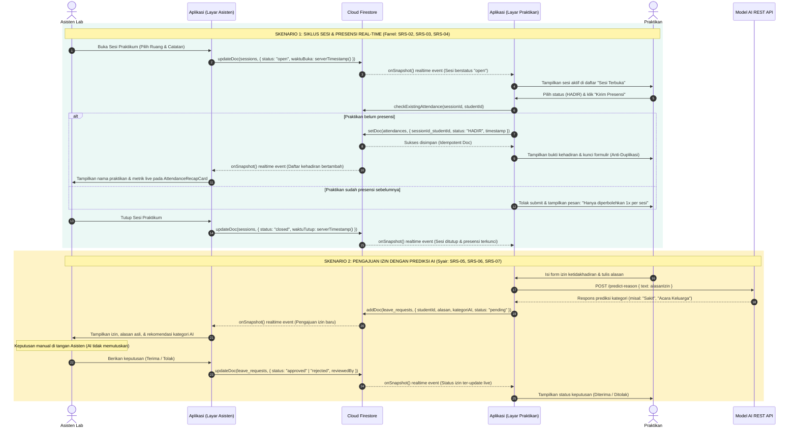
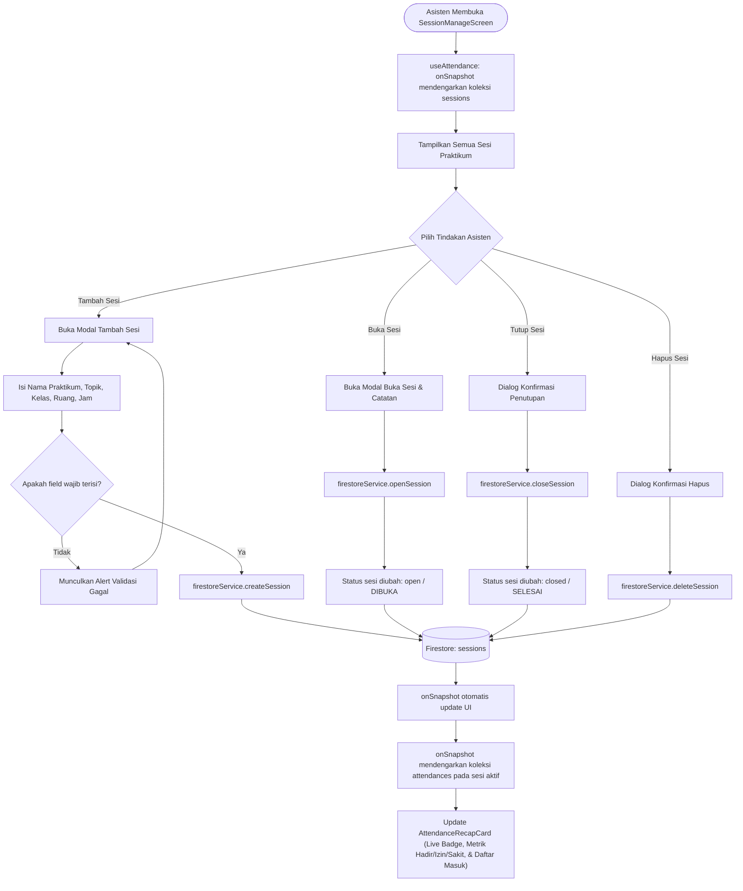
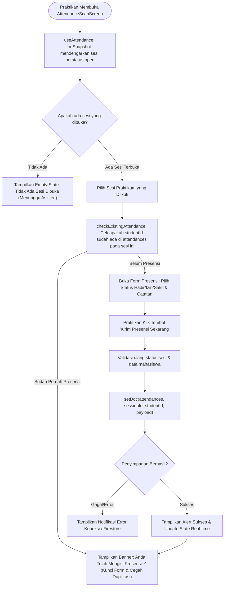
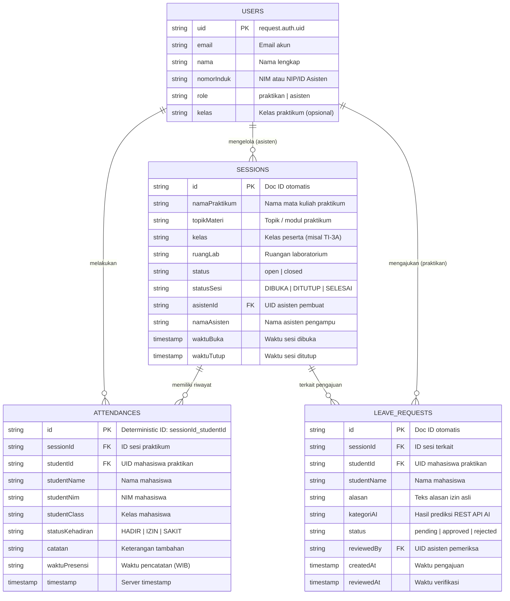

# Diagram Alur Kerja Sistem (Workflow Diagrams) — Sprint 2
## Presensi Praktikum Laboratorium dengan Firebase & AI

Dokumen ini memuat diagram alur kerja (*workflow diagrams*) lengkap untuk sistem Presensi Praktikum Laboratorium berbasis **Cloud Firestore**, **Firebase Authentication**, dan **REST API Model AI**, dengan fokus khusus pada modul **Programmer Farrel** (SRS-FT-02, SRS-FT-03, SRS-FT-04) serta integrasi alur keseluruhan.

---

## 1. Alur Utama Terintegrasi Sistem (End-to-End System Workflow)

Diagram berikut memetakan dua skenario inti yang diwajibkan pada Sprint 2:
1. **Alur Presensi Terintegrasi Real-Time (Asisten & Praktikan)**.
2. **Alur Pengajuan Izin & Klasifikasi AI (Praktikan, Model AI, & Asisten)**.

---

## 2. Alur Pengelolaan Sesi Praktikum — Sisi Asisten (SRS-FT-02 & SRS-FT-04)

Diagram alir logika (*flowchart*) bagi Asisten untuk operasi CRUD sesi, pembukaan/penutupan kegiatan, dan pemantauan live recap.

---

## 3. Alur Presensi Terintegrasi & Validasi 1x — Sisi Praktikan (SRS-FT-03)

Diagram alir logika (*flowchart*) bagi Praktikan ketika melakukan presensi pada sesi yang sedang dibuka dengan proteksi anti-duplikasi.

---

## 4. Arsitektur Relasi Koleksi Cloud Firestore (Sprint 2)

Diagram struktur data dan keterhubungan dokumen pada Cloud Firestore:

