# Diagram Alur Kerja (Workflow) Pelaksanaan Tugas Programmer Farrel
## Sprint 2: CRUD Sesi, Presensi Terintegrasi, & Real-Time Sync (SRS-FT-02, 03, 04)

Diagram di bawah ini menggambarkan **tahapan urutan kerja (*execution workflow*)** yang telah dilakukan oleh **Programmer Farrel** dari awal persiapan hingga proyek siap diajukan ke Pull Request.

Salin kode Mermaid di bawah ini ke [Mermaid Live Editor](https://mermaid.live).

```mermaid
flowchart TD
    START([Mulai Pengerjaan Farrel]) --> S1["1. Buat Branch Git<br/>feature/lab-attendance-firestore"]
    
    S1 --> S2["2. Pasang SDK Firebase<br/>npx expo install firebase"]
    
    S2 --> S3["3. Buat Service Firestore (firestoreService.js)<br/>• CRUD Sesi Praktikum (SRS-FT-02)<br/>• Presensi 1x Per Sesi (SRS-FT-03)<br/>• Realtime onSnapshot Listener (SRS-FT-04)"]
    
    S3 --> S4["4. Buat Hook Realtime (useAttendance.js)<br/>Mengelola state live sesi, presensi, & error recovery"]
    
    S4 --> S5["5. Buat Komponen & Layar Antarmuka<br/>• AttendanceRecapCard.js (Live Recap Asisten)<br/>• SessionManageScreen.js (Kelola Sesi Asisten)<br/>• AttendanceScanScreen.js (Presensi Praktikan)"]
    
    S5 --> S6["6. Pengujian & Perbaikan Sistem<br/>• Unit test logika presensi 1x (3/3 pass)<br/>• Kompilasi tsc 0 error & web bundler pass<br/>• Penanganan error gangguan koneksi & offline"]
    
    S6 --> S7["7. Dokumentasi & Diagram<br/>• Buat PRAKMOBILE2.md (Dokumen SRS)<br/>• Buat diagram.md (Workflow)"]
    
    S7 --> S8["8. Commit & Push ke GitHub<br/>Verifikasi 0 Konflik Merge ke main"]
    
    S8 --> FINISH([Siap Buat Pull Request])

    %% STYLING TAMPILAN
    style START fill:#EFF6FF,stroke:#3B82F6,stroke-width:2px
    style S1 fill:#FFFFFF,stroke:#64748B,stroke-width:2px
    style S2 fill:#FEF3C7,stroke:#D97706,stroke-width:2px
    style S3 fill:#DCFCE7,stroke:#16A34A,stroke-width:2px
    style S4 fill:#DCFCE7,stroke:#16A34A,stroke-width:2px
    style S5 fill:#DCFCE7,stroke:#16A34A,stroke-width:2px
    style S6 fill:#FEE2E2,stroke:#DC2626,stroke-width:2px
    style S7 fill:#F1F5F9,stroke:#475569,stroke-width:2px
    style S8 fill:#DBEAFE,stroke:#2563EB,stroke-width:2px
    style FINISH fill:#DCFCE7,stroke:#16A34A,stroke-width:2px
```



---

### Versi Ringkas untuk Digambar di Kertas:
```text
[ 1. Inisialisasi Branch Git: feature/lab-attendance-firestore ]
                             ↓
[ 2. Instalasi SDK Firebase via npx expo install firebase ]
                             ↓
[ 3. Coding firestoreService.js (CRUD Sesi & Presensi 1x) ]
                             ↓
[ 4. Coding useAttendance.js (Hook Real-time onSnapshot) ]
                             ↓
[ 5. Coding UI Screens: SessionManageScreen & AttendanceScanScreen ]
                             ↓
[ 6. Pengujian: Unit Test Presensi, Typecheck tsc, & Error Handling ]
                             ↓
[ 7. Pembuatan Dokumen SRS (PRAKMOBILE2.md) & Diagram ]
                             ↓
[ 8. Commit & Push ke GitHub (Bebas Konflik / Clean Merge) ]
```
