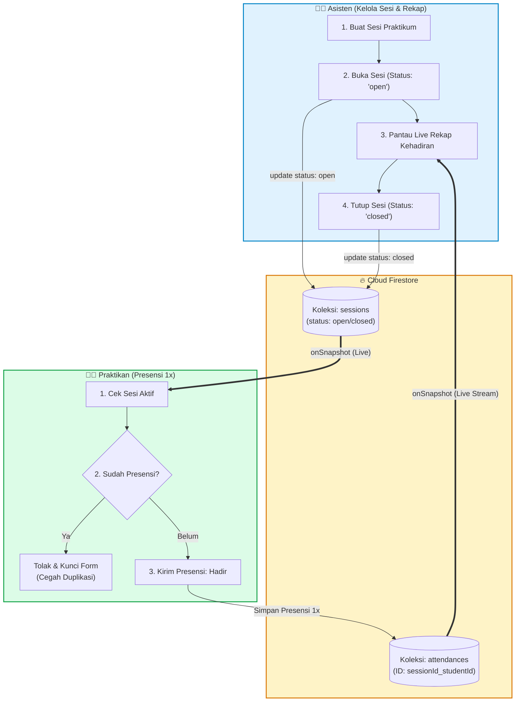

# Diagram Alur Kerja (Workflow) — Bagian Programmer Farrel
## Sprint 2: CRUD Sesi, Presensi Terintegrasi, & Real-Time Listener (SRS-FT-02, 03, 04)

Diagram ringkas di bawah ini dirancang khusus untuk memetakan tanggung jawab **Programmer Farrel** dan mudah disalin langsung ke [Mermaid Live Editor](https://mermaid.live) maupun digambar tangan pada kertas.

---

### 📝 Poin Penting untuk Catatan / Penjelasan Lisan Anda:
1. **SRS-FT-02 (Asisten)**: Asisten membuat sesi praktikum dan membuka sesi (`status: 'open'`) pada Firestore `sessions`.
2. **SRS-FT-03 (Praktikan)**: Praktikan mendeteksi sesi yang terbuka, mengisi presensi, dan sistem menyimpan dokumen dengan ID deterministik (`${sessionId}_${studentId}`) untuk memastikan **presensi hanya bisa 1 kali**.
3. **SRS-FT-04 (Real-time Sync)**: Menggunakan listener Firestore `onSnapshot()` sehingga pembukaan sesi langsung terlihat di HP praktikan, dan data presensi langsung muncul secara live di kartu rekap asisten tanpa reload.
