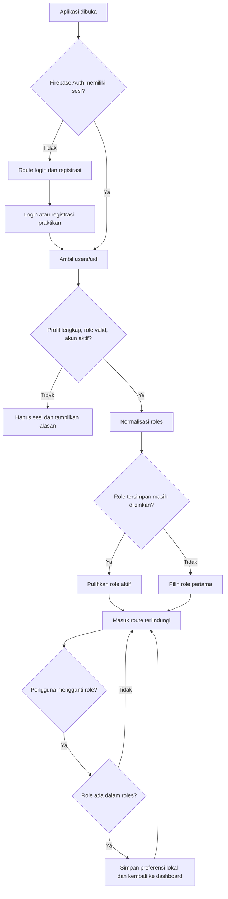
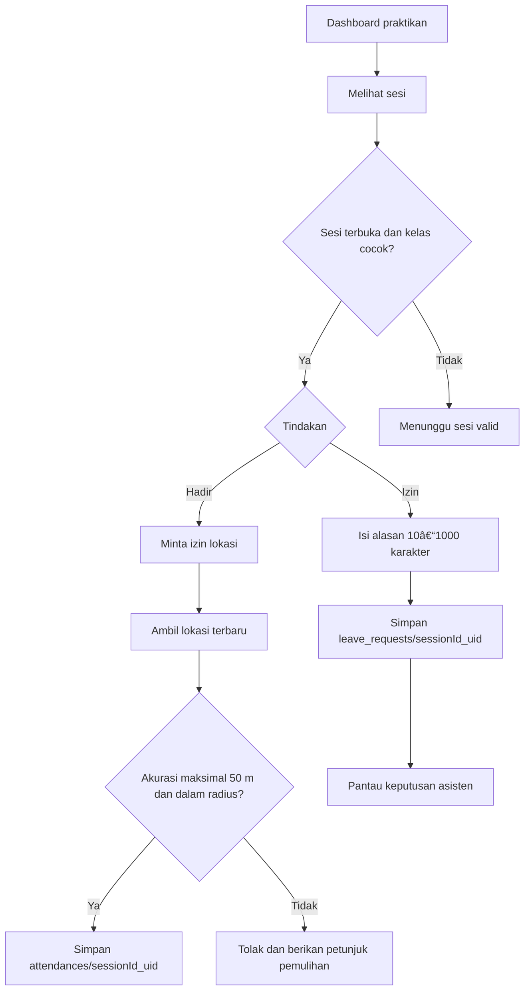
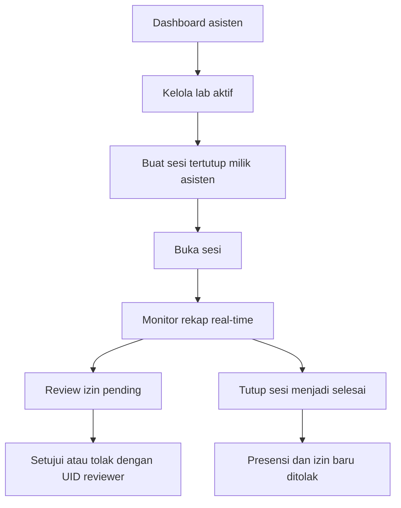

# User Flow, Role, dan Skema Auth

Dokumen ini menjadi kontrak operasional untuk autentikasi, otorisasi route, dan akses data aplikasi. Implementasi UI tidak boleh dianggap sebagai batas keamanan; keputusan akses akhir tetap berada pada Firestore Security Rules.

## Role dan Matriks Akses

| Area | Praktikan | Asisten | Tanpa Login |
|---|---:|---:|---:|
| Login dan registrasi praktikan | Tidak | Tidak | Ya |
| Dashboard, profil, peta lab | Ya | Ya | Tidak |
| Daftar sesi | Ya | Ya | Tidak |
| Presensi berbasis lokasi | Ya | Tidak | Tidak |
| Pengajuan dan status izin | Ya | Tidak | Tidak |
| Rekap seluruh presensi | Tidak | Ya | Tidak |
| Kelola lokasi lab | Tidak | Ya | Tidak |
| Kelola dan buka/tutup sesi | Tidak | Ya | Tidak |
| Review izin | Tidak | Ya | Tidak |

Akun dapat memiliki lebih dari satu role. `roles` adalah hak akses yang diprovisikan, sedangkan role aktif adalah preferensi tampilan lokal dan harus selalu merupakan anggota `roles`.

## Skema `users/{uid}`

| Field | Tipe | Sumber | Dapat diubah pengguna | Aturan |
|---|---|---|---:|---|
| `uid` | string | Firebase Auth | Tidak | Sama dengan UID dokumen dan `request.auth.uid`. |
| `email` | string | Firebase Auth | Tidak | Sama dengan email token saat registrasi. |
| `nama` | string | Form/profil | Ya | Panjang 2–100 karakter. |
| `nomorInduk` | string | Form/provisioning | Tidak | Identitas akademik tetap. |
| `kelas` | string | Form/provisioning | Tidak | Wajib untuk akun yang memiliki role praktikan. |
| `role` | `praktikan \| asisten` | Provisioning | Tidak | Role canonical/fallback dan harus ada di `roles`. |
| `roles` | array | Provisioning | Tidak | Satu atau dua role valid tanpa role lain. |
| `accountStatus` | `active \| suspended` | Provisioning | Tidak | Hanya akun aktif yang dapat memakai data aplikasi. |
| `createdAt` | timestamp | Server | Tidak | Tidak dapat diubah. |
| `updatedAt` | timestamp | Server | Otomatis | Harus sama dengan waktu request saat profil diperbarui. |

Registrasi publik hanya dapat membuat akun praktikan aktif dengan `role: "praktikan"` dan `roles: ["praktikan"]`. Pemberian role asisten, penambahan role kedua, perubahan kelas, dan suspensi akun harus dilakukan melalui Firebase Console atau backend administratif tepercaya.

## Alur Autentikasi dan Pemilihan Role

## User Flow Praktikan

## User Flow Asisten

## Proteksi Route

Proteksi diterapkan berlapis melalui `Stack.Protected` dan `Tabs.Protected`:

| Guard | Route |
|---|---|
| Publik | `/login`, `/register` |
| Semua akun aktif | `/(tabs)`, `/peta-lab` |
| Asisten | `/sesi`, `/lokasi-lab`, `/review-izin`, tab Rekap |
| Praktikan | `/presensi-lokasi`, `/pengajuan-izin`, `/status-izin`, tab Presensi |

Perubahan role aktif menyebabkan route yang tidak lagi berhak diakses dilepas dari navigator dan pengguna dikembalikan ke dashboard.

## Kontrak Data Sensitif

- Presensi menggunakan ID deterministik `${sessionId}_${uid}` sehingga satu akun hanya dapat presensi sekali per sesi.
- Pengajuan izin menggunakan ID deterministik yang sama sehingga satu akun hanya dapat membuat satu pengajuan per sesi.
- Nama, NIM, kelas, dan UID pada presensi/izin diverifikasi terhadap profil server, bukan dipercaya dari input UI.
- Presensi hanya diterima untuk sesi terbuka, kelas yang sama, lab aktif, lokasi maksimal berumur lima menit, akurasi maksimal 50 meter, dan jarak dalam radius lab.
- Hanya asisten pemilik sesi yang dapat mengubah atau menghapus sesi tersebut.
- Keputusan izin menyimpan nama dan UID reviewer; pengajuan yang sudah diputuskan tidak dapat diproses ulang.

## Provisioning dan Migrasi

1. Jalankan `npm run migrate:user-roles` untuk dry-run profil lama.
2. Tinjau profil tanpa role valid secara manual.
3. Jalankan `npm run migrate:user-roles -- --apply` menggunakan kredensial administratif.
4. Pastikan akun asisten memiliki `roles` yang memuat `asisten` dan `accountStatus: "active"`.
5. Deploy Rules dan indexes setelah migrasi data tervalidasi.

Perubahan role tidak disediakan melalui client mobile karena hak tersebut harus berada di administrative trust boundary.
