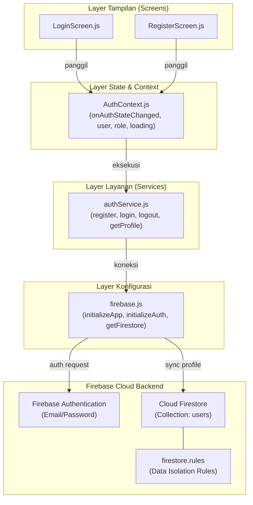

# Rencana Implementasi Sprint 2: Modul Autentikasi & Manajemen Pengguna (Azlan)

Dokumen ini merupakan panduan dan rencana kerja implementasi untuk **Azlan** pada branch `feature/auth-user-management` sesuai dengan pembagian tugas Sprint 2 aplikasi Presensi Praktikum Mobile.

---

## 1. Identitas Tugas & Lingkup Tanggung Jawab

- **Programmer**: Azlan
- **Branch Git**: `feature/auth-user-management`
- **Kode SRS**:
  - **SRS-FT-01**: Autentikasi Pengguna (Register, Login, Logout) berbasis Firebase Auth dan sinkronisasi data profil pengguna (`nama`, `nomorInduk`/NIM/NIP, `email`, `role`, `kelas`) pada koleksi Firestore `users`.
  - **SRS-FT-08**: Validasi form input, penanganan error (Auth & Firestore), serta penerapan Firebase Security Rules berbasis token JWT dan isolasi data per pengguna.
- **Berkas yang Wajib Dibuat / Dikelola**:
  1. `src/config/firebase.js` (Inisialisasi Firebase App, Auth dengan persistence, dan Firestore)
  2. `src/services/authService.js` (Layanan backend Auth & sinkronisasi Firestore)
  3. `src/context/AuthContext.js` (State Provider autentikasi dan peran pengguna)
  4. `src/screens/auth/LoginScreen.js` (Antarmuka login)
  5. `src/screens/auth/RegisterScreen.js` (Antarmuka registrasi pengguna & peran)
  6. `firestore.rules` (Aturan keamanan basis data Firestore)
  7. Integrasi Router / Navigasi Utama (Root layout Expo Router)

---

## 2. Persiapan Awal (Prasyarat & Konfigurasi)

### 2.1 Persiapan Akun & Project Firebase (Firebase Console)
1. **Membuat Project Firebase**:
   - Buka [Firebase Console](https://console.firebase.google.com).
   - Buat project baru (contoh: `ppk-mobile-praktikum` atau `lab-attendance-app`).
2. **Mengaktifkan Firebase Authentication**:
   - Masuk ke menu **Build** > **Authentication** > **Get Started**.
   - Pada tab **Sign-in method**, aktifkan provider **Email/Password**.
3. **Mengaktifkan Cloud Firestore**:
   - Masuk ke menu **Build** > **Firestore Database** > **Create Database**.
   - Pilih mode awal (Test Mode atau Production Mode) dan lokasi region (misal `asia-southeast2` Jakarta).
4. **Mendaftarkan Web App untuk Mendapatkan Konfigurasi**:
   - Di Project Overview > Project Settings > General > Your Apps, klik icon Web (`</>`).
   - Beri nama aplikasi (misal `lab-attendance-web-mobile`).
   - Salin objek `firebaseConfig` (API Key, Auth Domain, Project ID, Storage Bucket, Messaging Sender ID, App ID).
5. **Konfigurasi Environment Variables**:
   - Buat berkas `.env` (dan `.env.example`) dengan prefix Expo `EXPO_PUBLIC_FIREBASE_*` agar credential tidak terekspos langsung dalam repositori kode.

### 2.2 Instalasi Dependensi Proyek
Proyek menggunakan Expo SDK 57 (React 19 & React Native 0.86). Dependensi yang dibutuhkan:
```bash
npx expo install firebase @react-native-async-storage/async-storage
```
- `firebase`: SDK Firebase JS v10/v11 (Modular API).
- `@react-native-async-storage/async-storage`: Diperlukan agar sesi login user tersimpan secara persisten di penyimpanan lokal perangkat mobile menggunakan `initializeAuth` + `getReactNativePersistence`.

---

## 3. Rencana Arsitektur & Langkah Implementasi



### Tahap 1: Setup Branch & Dependensi
- Pastikan berada di branch `feature/auth-user-management`.
- Install paket `firebase` dan `@react-native-async-storage/async-storage`.
- Siapkan berkas konfigurasi environment `.env`.

### Tahap 2: Konfigurasi Firebase SDK (`src/config/firebase.js`)
- Mengimpor fungsi modular `initializeApp` dari `firebase/app`.
- Mengonfigurasi `initializeAuth` dengan `getReactNativePersistence(AsyncStorage)` dari `firebase/auth` untuk persistensi sesi mobile.
- Menginisialisasi `getFirestore` dari `firebase/firestore`.
- Mengekspor `app`, `auth`, dan `db`.

### Tahap 3: Service Layer Autentikasi (`src/services/authService.js`)
- `registerUser({ email, password, nama, nomorInduk, role, kelas })`:
  - Membuat user baru di Firebase Auth (`createUserWithEmailAndPassword`).
  - Menulis dokumen profil ke koleksi `users/${user.uid}` di Firestore dengan data:
    `{ uid, nama, nomorInduk, email, role, kelas, createdAt }`.
- `loginUser(email, password)`:
  - Otentikasi kredensial via `signInWithEmailAndPassword`.
  - Mengambil dokumen profil pengguna dari Firestore untuk mengetahui role (`asisten` / `praktikan`).
- `logoutUser()`:
  - Memanggil `signOut(auth)`.
- `getUserProfile(uid)`:
  - Mengambil data profil user dari Firestore berdasarkan UID.
- Penanganan error kode Firebase (misal: `auth/email-already-in-use`, `auth/wrong-password`, `auth/user-not-found`, `auth/invalid-credential`).

### Tahap 4: State Provider (`src/context/AuthContext.js`)
- Membuat React Context `AuthContext` dan hook `useAuth()`.
- Menyimpan state:
  - `user`: Objek pengguna aktif dari Firebase Auth.
  - `userProfile`: Objek profil pengguna dari Firestore (`role`, `nama`, `nomorInduk`, `kelas`).
  - `loading`: Boolean status loading saat inisialisasi sesi aplikasi.
- Menggunakan `onAuthStateChanged(auth, callback)` untuk mendengarkan perubahan status login secara real-time dan memuat profil pengguna secara otomatis saat aplikasi dibuka.
- Menyediakan method `login`, `register`, `logout` ke seluruh komponen anak.

### Tahap 5: Antarmuka Pengguna (Screens)
- **`src/screens/auth/LoginScreen.js`**:
  - Input field: Email dan Password.
  - Validasi form (format email, panjang password).
  - Tampilan feedback error / loading indicator.
  - Tombol aksi Login dan navigasi menuju Register.
- **`src/screens/auth/RegisterScreen.js`**:
  - Input field: Nama Lengkap, Nomor Induk (NIM / NIP), Email, Password, Konfirmasi Password.
  - Selektor Peran: `Praktikan` atau `Asisten`.
  - Input Kelas (kondisional untuk Praktikan).
  - Validasi komprehensif sebelum pemanggilan service.
  - Navigasi kembali ke Login jika sudah memiliki akun.

### Tahap 6: Keamanan Basis Data (`firestore.rules`)
- Menuliskan aturan keamanan Firestore untuk:
  - Koleksi `users/{userId}`: Pengguna hanya dapat membaca dan menulis profil miliknya sendiri (`request.auth.uid == userId`), atau asisten dapat membaca nama/NIM untuk keperluan absensi.
  - Koleksi `sessions`, `attendances`, `leave_requests` (dipersiapkan untuk modul Farrel & Syair).

### Tahap 7: Integrasi Routing (Expo Router)
- Menghubungkan `AuthProvider` pada root layout `src/app/_layout.tsx`.
- Melakukan conditional routing (jika belum login arahkan ke screen Auth; jika sudah login arahkan ke tabs praktikum sesuai peran).

---

## 4. Rencana Pengujian & Validasi

1. **Pengujian Registrasi**:
   - Registrasi user sebagai Praktikan -> verifikasi akun di Firebase Auth Console dan dokumen di Firestore `users/{uid}`.
   - Registrasi user sebagai Asisten -> verifikasi role tersimpan sebagai `asisten`.
2. **Pengujian Login & Persistensi**:
   - Login dengan kredensial yang valid -> berhasil masuk ke antarmuka aplikasi.
   - Tutup dan buka kembali aplikasi -> sesi login tetap aktif tanpa harus login ulang (AsyncStorage persistence).
   - Login dengan password salah -> muncul pesan error yang jelas dan ramah pengguna.
3. **Pengujian Logout**:
   - Melakukan logout -> sesi berakhir dan diarahkan kembali ke layar Login.
4. **Validasi Typecheck & Build**:
   - Menjalankan `npx tsc --noEmit` untuk memastikan tidak ada konflik tipe data.

